# Mind the Gap Man – Superhero Services for Hire

**Live site:** [https://cyberjkb.github.io/mind-the-gap/](https://cyberjkb.github.io/mind-the-gap/)

**Repository:** [https://github.com/cyberjkb/mind-the-gap](https://github.com/cyberjkb/mind-the-gap)

Mind the Gap Man is London's most affordable (and most easily delayed) superhero. This is a parody website: a three-page static site, plus a form confirmation page, built for Code Institute Milestone Project 1 with HTML5, CSS3 and Bootstrap 5.3.3. It looks like a comic book and uses London Underground styling. Distressed Londoners can read the hero's origin story, compare the Bronze, Silver and Gold rescue tiers, and send a distress signal to book a rescue.

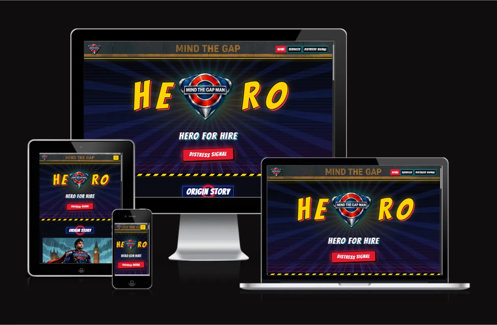

---

## Table of Contents

1. [User Experience (UX)](#user-experience-ux)
   - [Site Purpose and Goals](#site-purpose-and-goals)
   - [User Stories](#user-stories)
2. [Design](#design)
   - [Colour Palette](#colour-palette)
   - [Typography](#typography)
   - [Imagery](#imagery)
   - [Comic Book Design Rationale](#comic-book-design-rationale)
3. [Wireframes](#wireframes)
4. [Features](#features)
   - [Shared: Header and Navigation](#shared-header-and-navigation)
   - [Shared: Footer](#shared-footer)
   - [Home Page](#home-page-indexhtml)
   - [Services and Pricing Page](#services-and-pricing-page-serviceshtml)
   - [Distress Signal (Contact) Page](#distress-signal-contact-page-contacthtml)
   - [Thank You Page](#thank-you-page-thank-youhtml)
   - [Future Features](#future-features)
5. [Technologies Used](#technologies-used)
6. [Accessibility](#accessibility)
7. [Testing](#testing)
8. [Bugs](#bugs)
9. [Deployment](#deployment)
10. [Credits](#credits)
11. [Declaration of AI Use](#declaration-of-ai-use)

---

## User Experience (UX)

### Site Purpose and Goals

**Purpose:** This is a funny, eye-catching parody site that "sells" the services of a local, budget superhero. It shows how a small service business can present who it is, what it offers, how much it costs and how to book. The site uses structured HTML, CSS and Bootstrap, and the experience feels like a comic book.

**External user's goal (a distressed London citizen):**

- Find clear, easy-to-understand information about hiring a local, affordable superhero.
- Find out which everyday crises he handles, such as spiders, stuck jars, cats up trees, Wi-Fi outages and arch-nemeses.
- Compare prices and response times, then book a rescue quickly.

**Site owner's goal:**

- Build a funny, striking parody page with a clear persona from the first screen.
- Set out the heroic services, response times and pricing tiers in a structured, comparable way.
- Turn visitors into "distress signals" (form submissions) using clear calls to action on every page.

### User Stories

The user stories are tracked as issues on the [Mind The Gap Man Project Board](https://github.com/users/cyberjkb/projects/7) (MoSCoW labels). Duplicate issues (#4 duplicates #3, #7 duplicates #6) are listed once.

#### Must-Have

| Issue | As a... | I want... | So that... | Where it is met |
| --- | --- | --- | --- | --- |
| [#1](https://github.com/cyberjkb/mind-the-gap/issues/1) | distressed citizen on the Tube | easy navigation and a responsive layout | I can find superhero information quickly on any device | Shared responsive navbar (Home, Services, Distress Signal) with a hamburger menu; Bootstrap grid on every page |
| [#2](https://github.com/cyberjkb/mind-the-gap/issues/2) | curious Londoner | high-quality images and an engaging origin story | I understand who the hero is and what his mission is | Hero banner with logo and slogan; Origin Story section with comic artwork and the "Bitten by code..." backstory |
| [#3](https://github.com/cyberjkb/mind-the-gap/issues/3) | potential client | to explore hireable services and prices on a separate page | I can choose the right package | `services.html`: six service cards with images, Bronze/Silver/Gold tier cards with prices, and a comparison table |
| [#5](https://github.com/cyberjkb/mind-the-gap/issues/5) | citizen in an emergency | a simple distress form | I can request help quickly and get confirmation | `contact.html` Web3Forms distress form with required fields, redirecting to `thank-you.html` |

#### Should-Have

| Issue | As a... | I want... | So that... | Where it is met |
| --- | --- | --- | --- | --- |
| [#6](https://github.com/cyberjkb/mind-the-gap/issues/6) | commuter | operating hours, active Tube zones and contact details | I don't try to summon the hero outside his jurisdiction | Hero HQ card on `contact.html` (hotline, email, HQ, hours); zone limits in the Weaknesses list |

#### Could-Have

| Issue | As a... | I want... | So that... | Where it is met |
| --- | --- | --- | --- | --- |
| [#8](https://github.com/cyberjkb/mind-the-gap/issues/8) | amused visitor | clear, funny information about the hero's weaknesses and boundaries | I understand the limits of his powers (and get a laugh) | Superpowers & Weaknesses Bootstrap list groups on the home page (e.g. "Will not fight south of Zone 4 after 9 PM") |
| [#9](https://github.com/cyberjkb/mind-the-gap/issues/9) | modern tech visitor | to switch between a dark and a light mode | I can see the site change from light-hearted to dark thriller | Not yet built: the site currently ships in the dark "night patrol" theme only (see [Future Features](#future-features)) |

---

## Design

### Colour Palette

The theme is **"the dark knight meets cyberpunk"**: a night-black graphic-novel page where the two classic **London Underground** colours, roundel red and corporate blue, are pushed to neon so they glow. Cyan and magenta add the cyberpunk accent, and the platform-edge **warning yellow** gives the comic lettering its punch. Every colour is defined once as a CSS custom property in `:root` in `assets/css/style.css`. The site also sets `data-bs-theme="dark"` on `<html>` and re-points Bootstrap's dark-mode variables at this palette, so cards, tables, list groups and forms all match.

| Swatch | Variable | Hex | Role |
| --- | --- | --- | --- |
|  | `--night` | `#07080d` | Page background (Gotham-at-midnight black) |
|  | `--panel` | `#11131c` | Comic panel and card backgrounds |
|  | `--line` | `#3d4766` | Gunmetal panel outlines |
|  | `--tube-red` | `#e3192d` | Distress buttons, roundel rings, active nav link |
|  | `--neon-red` | `#ff2a3d` | Red comic panel shadows and glows |
|  | `--tube-blue` | `#2d5bff` | Electric blue buttons, roundel name-bars |
|  | `--tube-blue-dark` | `#0b1440` | Midnight navy fills |
|  | `--neon-cyan` | `#00f0ff` | Links, nav outlines, hover glows, speech bubbles |
|  | `--neon-magenta` | `#ff2bd6` | Glitch text effect, hero grid floor |
|  | `--platform-yellow` | `#ffd300` | "Mind the gap" yellow: hero letters, captions, comic buttons, hazard stripe |
|  | `--text` | `#e7e9f2` | Body text on dark |

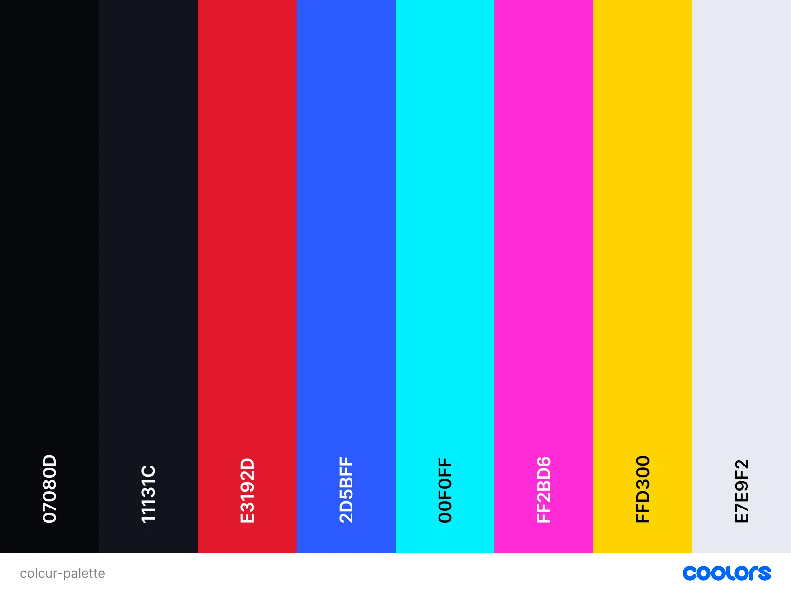

### Typography

- **[Bangers](https://fonts.google.com/specimen/Bangers)** (Google Fonts) is the display font. It is used for headings, buttons, the hero banner, comic captions and the footer heading. Its hand-lettered shape recreates classic comic lettering. The first letter or word of some headings is wrapped in a `.comic-tilt` span and rotated slightly, so it looks hand-inked.
- **[Open Sans](https://fonts.google.com/specimen/Open+Sans)** (Google Fonts) is the body font. It is used for paragraphs, form fields, tables and the copyright line. It is clean and easy to read at small sizes, which balances the busy display font.
- Fallback stacks: `'Bangers', 'Impact', 'Arial Black', sans-serif` and `'Open Sans', 'Segoe UI', Roboto, Arial, sans-serif`.

### Imagery

- **Logo:** a Mind the Gap Man shield logo on a transparent background, used in the navbar and in place of the "O" gap in the hero word "HE[logo]RO".
- **Navbar background:** a photo of a platform floor with the "MIND THE GAP" warning painted on it (`mind-the-gap-platform-floor-crop.webp`). On screens 1200px and wider it uses `mind-the-gap-platform-floor-wide.webp`, a copy whose plain asphalt edges were extended by mirroring (with Python Pillow), so the photo can stay centred at a fixed size without stretching.
- **Comic panels:** spider removal, jar opening, cat stuck in a tree, Wi-Fi down, queue jumping, arch-nemesis defeat, the origin story and the SOS distress signal, all drawn in comic illustration style.
- All raster images are **WebP**, have explicit `width`/`height` to avoid layout shift, and use `loading="lazy"` below the fold. The favicon is an SVG roundel.
- **Responsive images:** large images also have smaller 300 / 600 / 800px copies (for example `jar-600w.webp`), listed in each `` with `srcset` and `sizes`. The browser downloads the smallest copy that is still sharp for the screen, so phones load much less data. Below 992px the navbar uses a 1600px copy of the floor photo.

### Comic Book Design Rationale

- **Dark graphic-novel panels:** every card is a near-black panel with a gunmetal outline and a hard **blood-red offset shadow** (`--ink-shadow-lg`), the Dark Knight accent that lifts panels off the black page. Clickable panels swap to a neon cyan shadow on hover.
- **Night-city hero banner, built in pure CSS:** a yellow "signal in the sky" spotlight behind the logo, blue searchlight rays, CRT scanlines and a neon perspective grid floor, all from CSS gradients with no extra image files. The DISTRESS SIGNAL button pulses like an alarm light (turned off for users who prefer reduced motion).
- **Glitch lettering:** section titles and the tagline use a cyan/magenta split `text-shadow`, the classic cyberpunk "glitch".
- **Comic strip layout:** the five services sit in a 3 + 2 panel grid with black gutters, like a real comic page.
- **Speech bubbles, yellow caption boxes and "BANG!" starbursts** carry the jokes and mark out important information.
- **The yellow and black hazard stripe** (`.gap-stripe`) separates sections, like the edge of a platform.
- **Tube roundel headings** (`.roundel-title`) put each section title over a glowing red ring, which ties the comic look to the London setting.

---

## Wireframes

The first three wireframes were drawn by hand before development. The final one is a low-to-mid fidelity wireframe of the finished site, showing how the desktop and mobile layouts were built.

| Wireframe | Description |
| --- | --- |
| 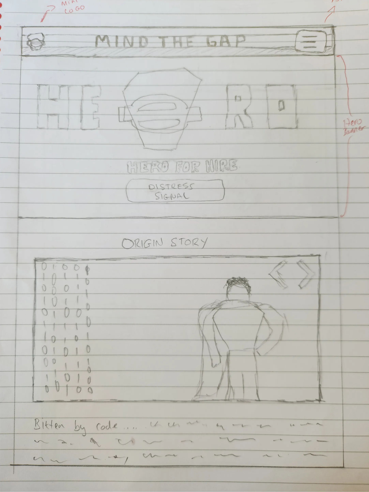 | **Wireframe 1:** navbar on a platform-floor background, HERO banner and origin story layout |
| 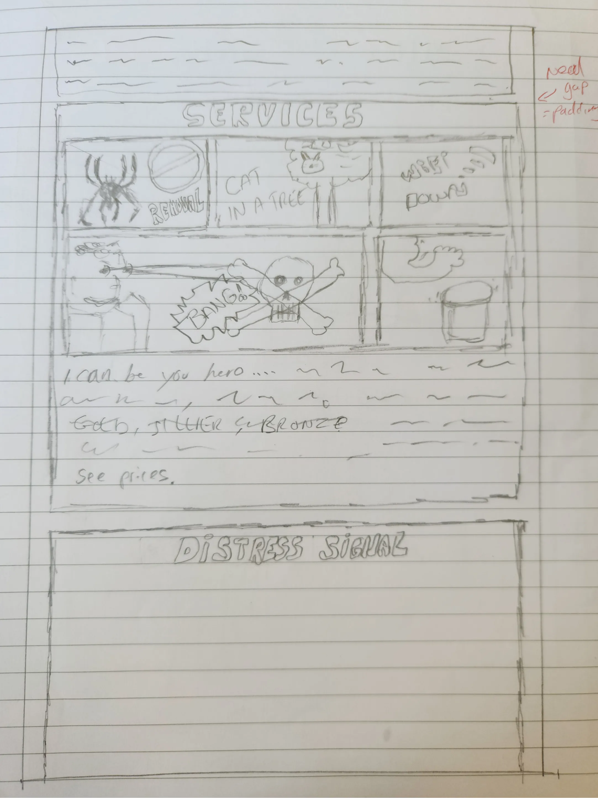 | **Wireframe 2:** services, tier summary and distress signal call to action |
| 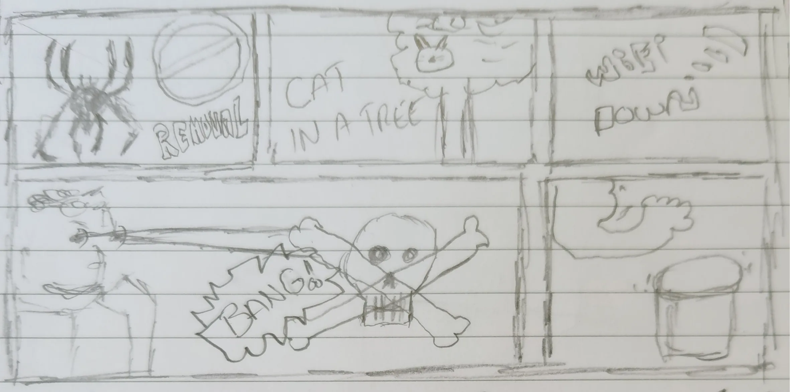 | **Comic strip sketch:** the 3 + 2 panel layout for the five services |
| 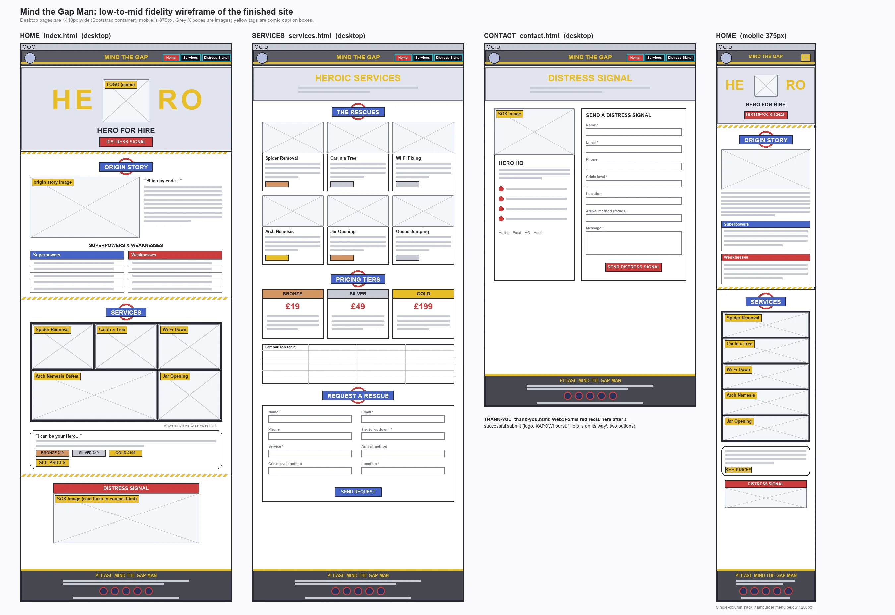 | **Site wireframe (as built):** the final page structure of Home, Services and Contact on desktop, and the stacked mobile Home layout |

---

## Features

The site has three main pages and a confirmation page. They share a navbar and footer. There is **no custom JavaScript**: the only script is the Bootstrap bundle, which powers the navbar collapse, plus the Font Awesome kit for icons.

### Shared: Header and Navigation

- A responsive Bootstrap navbar sits on a platform-floor background with the "MIND THE GAP" text.
- The shield logo links back to the home page.
- The links are Home, Services and Distress Signal. The current page is highlighted with `active` and `aria-current="page"`.
- On tablet and mobile the links collapse into a hamburger menu.
- **User benefit:** navigation stays the same and is easy to find on every page and device, and the distress signal is always one click away.

| Screen Size | Display |
| --- | --- |
| Desktop | 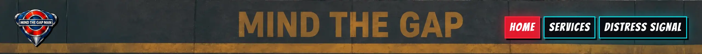 |
| Mobile (collapsed / expanded) | 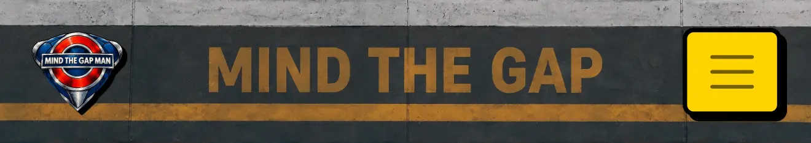 |

### Shared: Footer

- The footer has a navy background with a yellow platform-edge stripe.
- It shows Tube-style announcements as jokes ("This hero is now arriving. Please stand clear of the cape.").
- Font Awesome social icons (Facebook, X, Instagram, YouTube, TikTok) link to each platform's homepage. Each opens in a new tab and has a descriptive `aria-label`.
- The copyright and parody disclaimer is in plain, readable Open Sans.
- **User benefit:** every page ends the same way, with social links, and the parody status is clear.

| Screen Size | Display |
| --- | --- |
| Desktop | 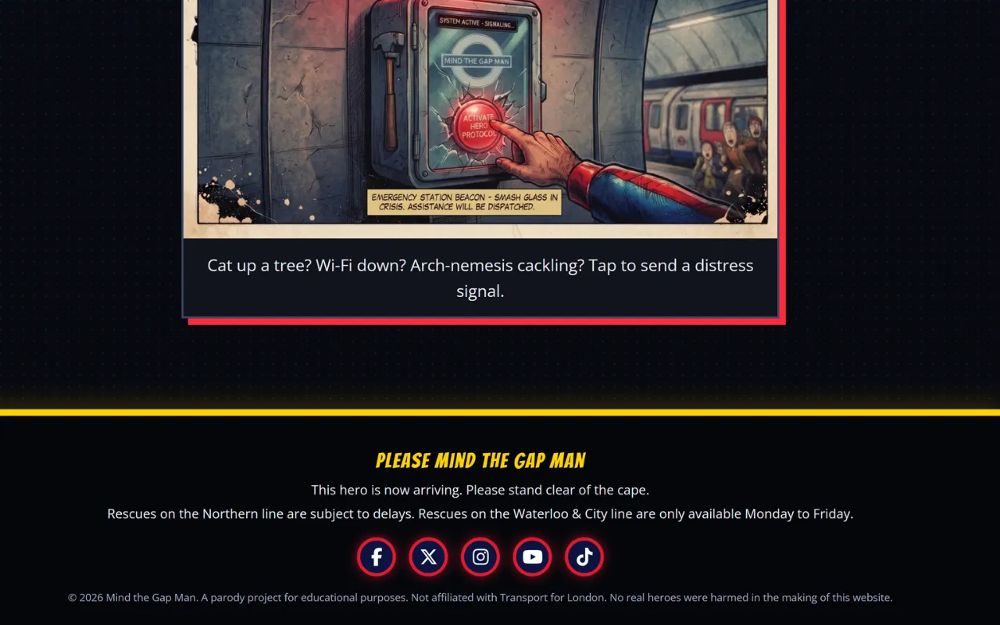 |
| Mobile | 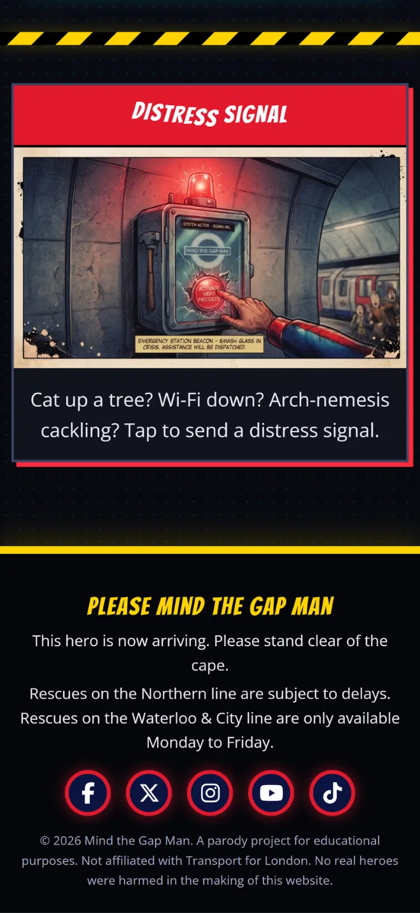 |

### Home Page (`index.html`)

#### Hero Banner

- The word **HE[logo]RO** is set in tilted yellow Bangers letters, with the shield logo as the "O" gap. It is followed by the tagline **"HERO FOR HIRE"** and a large red **DISTRESS SIGNAL** button that links to the contact page.
- **Spinning superhero logo (pure CSS, no JavaScript):** the shield whirls in with two full turns when the page loads, like a classic TV superhero scene transition. Hovering anywhere over the HERO word spins it one turn clockwise, and it spins back anti-clockwise when the pointer leaves. The hover sits on the whole word rather than the spinning image, so the spin never flickers, and both effects are switched off for users who prefer reduced motion.
- **User benefit:** the persona and the main call to action are clear straight away (user stories #2, #1).

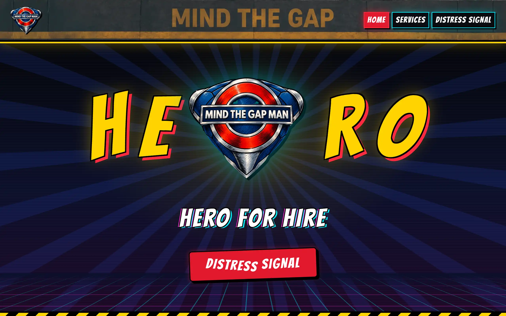

#### Origin Story

- A comic panel tells the story ("Bitten by code...") next to a Bootstrap list group of **Superpowers and Weaknesses**, including "Will not fight south of Zone 4 after 9 PM".
- **User benefit:** it entertains visitors and shows what the hero will and won't do (#8).

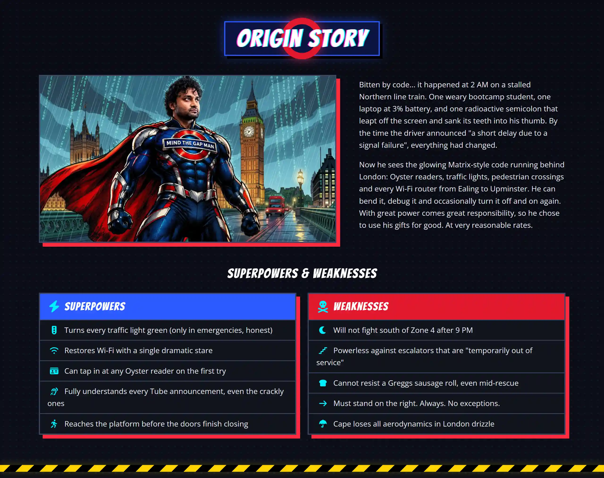

#### Services Comic Strip

- A five-panel comic strip in a 3 + 2 layout: Spider Removal, Cat in a Tree, Wi-Fi Down, Arch-Nemesis Defeat and Jar Opening. Each panel has a caption and a tier badge, and the whole strip links to the services page.
- **User benefit:** a quick, visual overview of what's on offer (#3).

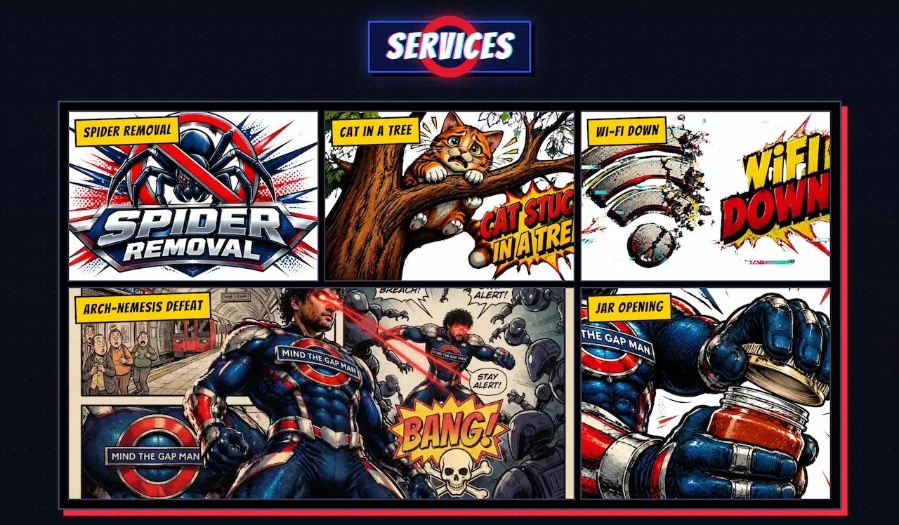

#### "I can be your Hero..." Tier Summary

- A short summary of the Bronze (£19), Silver (£49) and Gold (£199) tiers, with a link to the full comparison.
- **User benefit:** visitors see prices early, without leaving the home page (#3).

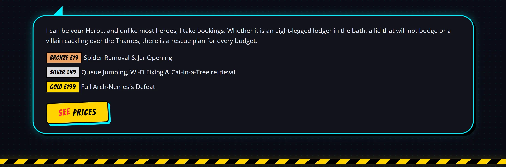

#### Distress Signal SOS Card

- A clickable SOS card that takes the user to the distress form.
- **User benefit:** a second, eye-catching route to booking at the end of the page (#5).

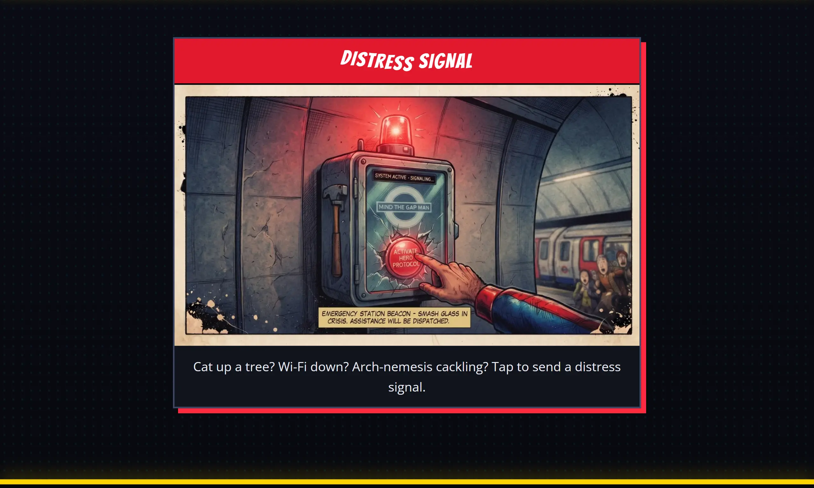

| Desktop | Mobile |
| --- | --- |
| 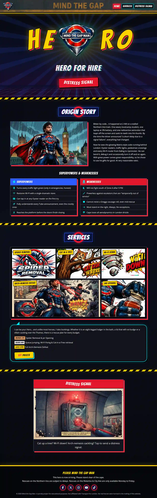 | 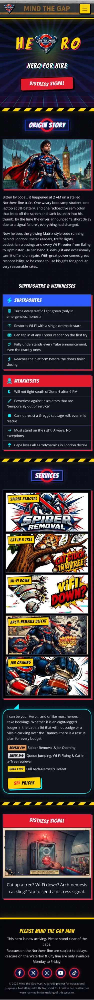 |

### Services and Pricing Page (`services.html`)

#### Service Detail Cards

- Bootstrap cards for each of the five services, each with a comic illustration, a description and a tier badge.
- **User benefit:** full detail on what each rescue covers (#3).

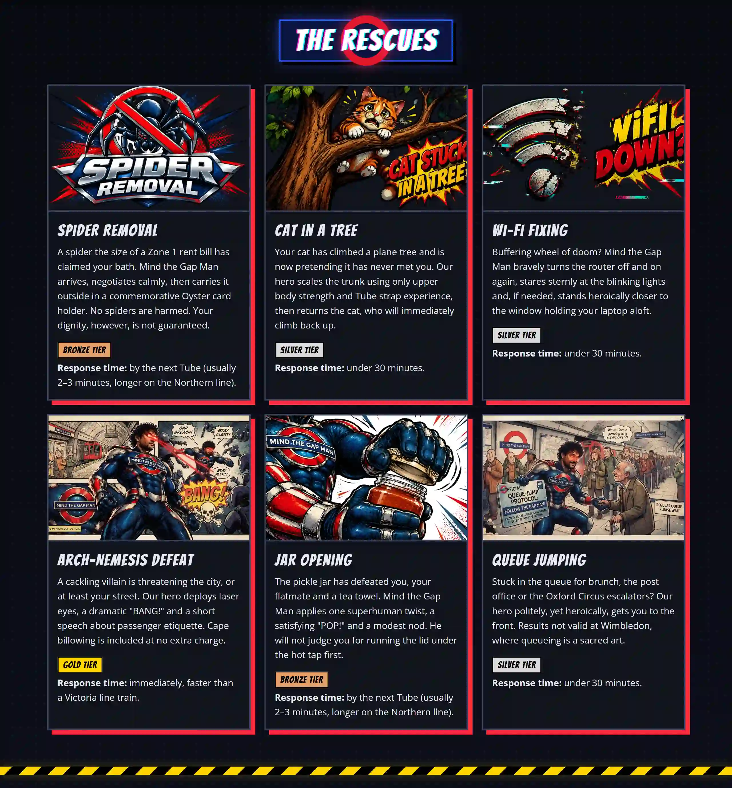

#### Tier Cards and Comparison Table

- Three pricing cards: **Bronze £19**, **Silver £49** and **Gold £199** per rescue. Each lists its services and response time, from "by the next Tube" to "faster than a Victoria line train".
- A responsive comparison table shows what is included in each tier.
- **User benefit:** a structured, side-by-side comparison makes it easy to choose (#3).

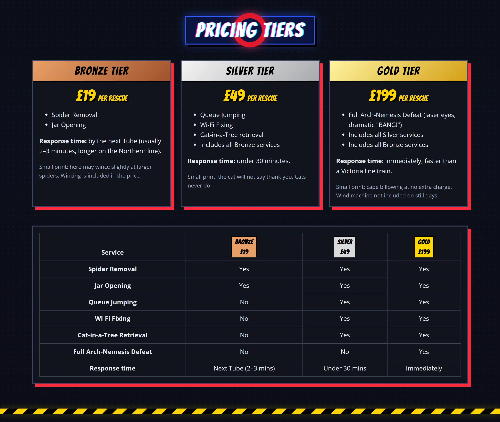

#### Rescue Request Form

- A [Web3Forms](https://web3forms.com/) form with a tier dropdown, labelled required fields and a hidden honeypot spam trap. There is deliberately no cart or online payment.
- After the form is submitted, the user is taken to the thank-you page.
- **User benefit:** users can book a chosen tier without leaving the pricing page (#5).

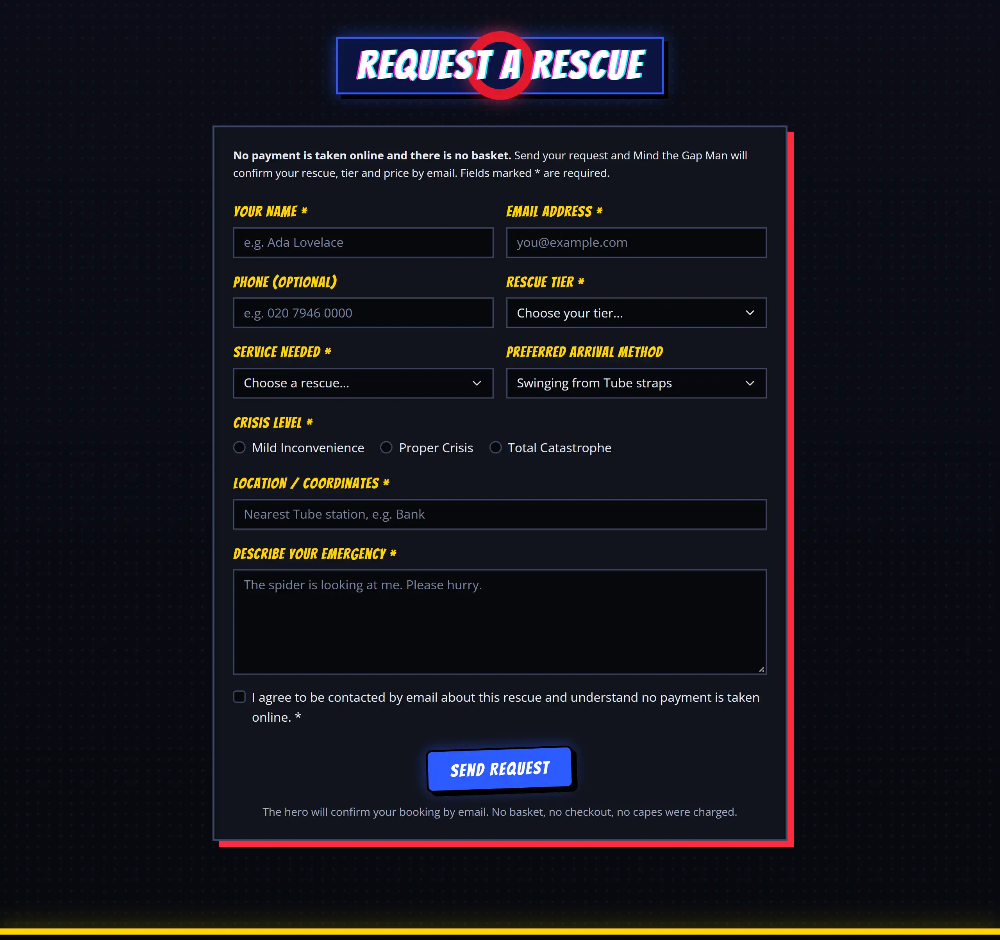

| Desktop | Mobile |
| --- | --- |
| 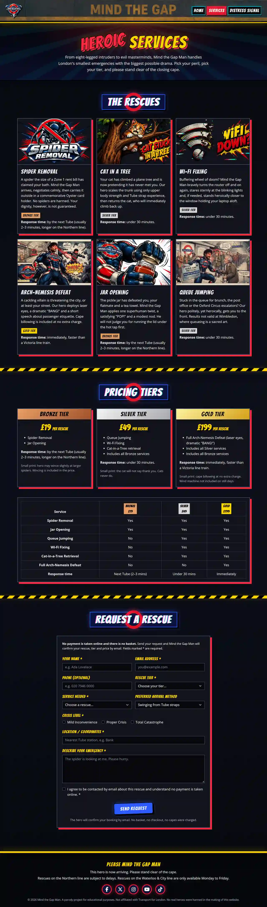 | 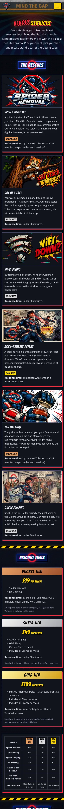 |

### Distress Signal (Contact) Page (`contact.html`)

- **Fictional HQ details:** hotline `020 8010 1010`, `distress@mindthegapman.example`, "Behind the yellow line, Platform 2, Bank Station" and opening hours "24/7, except during engineering works".
- **Distress form (Web3Forms):** name, email, crisis details and other fields, all with labels and validation, using red distress styling.
- **User benefit:** a dedicated, clear place to call for help, with confirmation after sending (#5, #6).

| Desktop | Mobile |
| --- | --- |
| 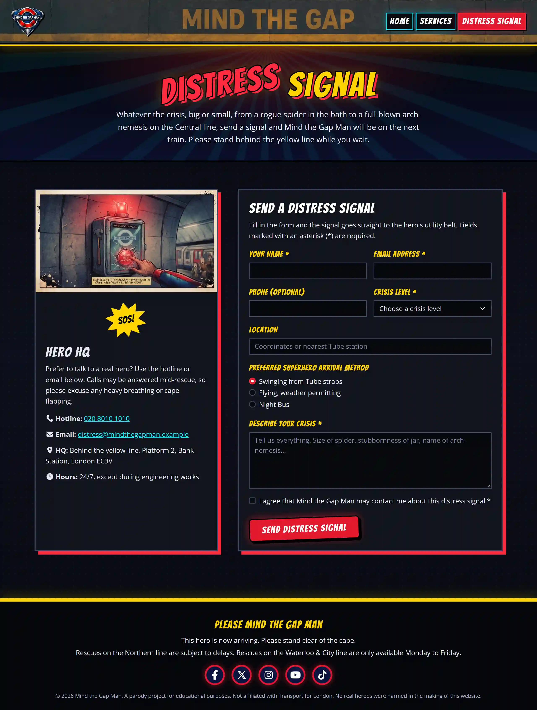 | 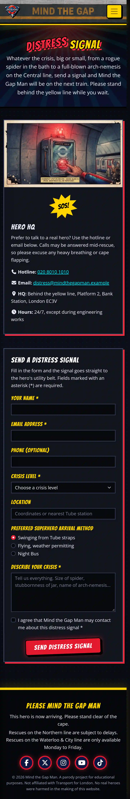 |

### Thank You Page (`thank-you.html`)

- A pure-HTML confirmation page that Web3Forms redirects to after a successful submission. It reassures the user that help is "on the next train" and links back to the rest of the site.
- **User benefit:** instant feedback that the distress signal was received (#5), without any custom JavaScript.

| Desktop | Mobile |
| --- | --- |
| 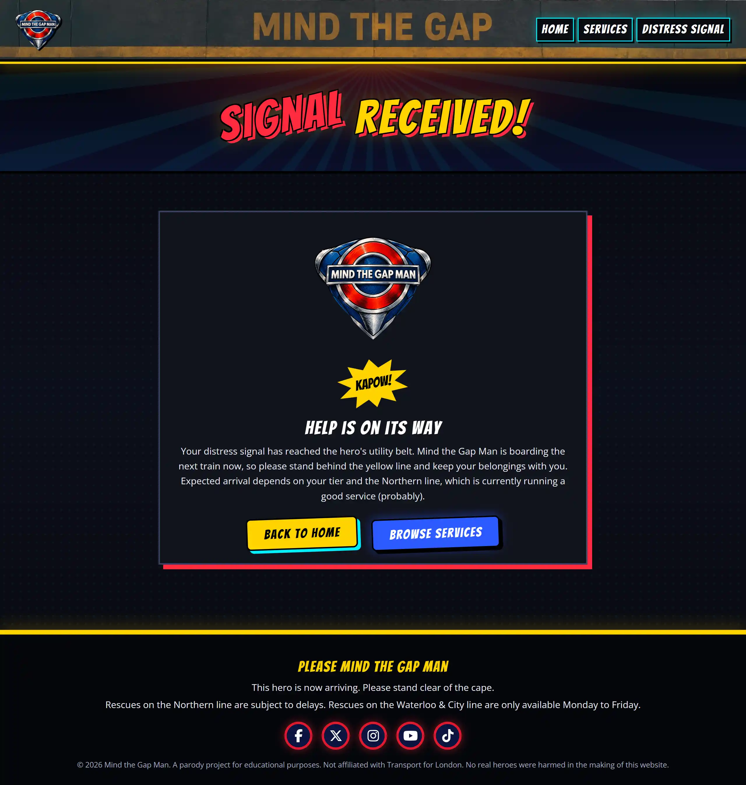 | 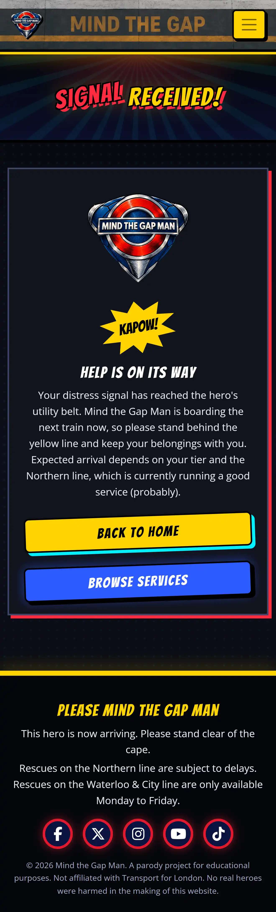 |

### Future Features

- **Citizen testimonials** from rescued Londoners, for example as a Bootstrap carousel of speech bubbles.
- **Live crime and inconvenience stats** (e.g. "Spiders evicted this week") from the brief.
- **Origin story carousel:** turn the origin story into a swipeable sequence of comic panels.
- **Online booking and payment** for pre-paid rescues.
- **Faster mobile loading:** switch the Font Awesome kit from "SVG + JavaScript" to "Web Font" mode in the Font Awesome account, which would remove its 539 KB icon library (see [TESTING.md](TESTING.md#performance-considerations)).
- **Night / day mode switch** (project board issue #9): a hidden "Easter egg" toggle between the dark night-patrol theme and a lighter daytime comic theme.

---

## Technologies Used

- **HTML5:** page structure and semantic markup.
- **CSS3:** custom comic theme, using CSS custom properties, Flexbox and media queries.
- **[Bootstrap 5.3.3](https://getbootstrap.com/docs/5.3/):** responsive grid, navbar, cards, list groups, tables and form components. The JS bundle is used only for the navbar collapse.
- **[Google Fonts](https://fonts.google.com/):** Bangers and Open Sans.
- **[Font Awesome](https://fontawesome.com/):** social and contact icons.
- **[Web3Forms](https://web3forms.com/):** sends form submissions by email from a static site, with no backend or JavaScript.
- **Git and [GitHub](https://github.com/):** version control and hosting. The project was planned on a [GitHub Projects Kanban board](https://github.com/users/cyberjkb/projects/7/views/1).
- **[GitHub Pages](https://pages.github.com/):** deployment.
- **Visual Studio Code:** code editor.
- **[Coolors](https://coolors.co/):** colour palette.
- **[Squoosh](https://squoosh.app/):** image conversion to WebP.
- **[Canva](https://canva.com/):** image generation and image conversion to WebP.
- **[W3C Markup Validator](https://validator.w3.org/), [W3C Jigsaw CSS Validator](https://jigsaw.w3.org/css-validator/), Chrome DevTools Lighthouse and [WAVE](https://wave.webaim.org/):** testing.
- **[Am I Responsive?](https://fireship.dev/amiresponsive):** multi-device showcase mockup.
- **[Playwright](https://playwright.dev/) and the [Lighthouse CLI](https://github.com/GoogleChrome/lighthouse):** automated functional testing of the live site and Lighthouse reports (testing only, not part of the website).
- **Python [Pillow](https://python-pillow.org/):** generated the smaller responsive image copies, the extra-wide navbar photo and the site wireframe image.
- **AI [Gemini, Claude & Co-pilot]:** Code checking and analysis, site structure creation, surface guidance, page testing and debugging.

---

## Accessibility

- Semantic landmarks (`header`, `nav`, `main`, `section`, `footer`), with exactly one `<h1>` per page and no skipped heading levels.
- Meaningful `alt` text on every image. Decorative dividers have `aria-hidden="true"`.
- Icon-only links (social icons) have descriptive `aria-label`s that say they open in a new tab. The icons themselves are `aria-hidden`.
- Every form control has a matching `<label for>`. Required fields use the native `required` attribute, so the browser gives immediate feedback.
- The current page is marked with `aria-current="page"` in the navbar.
- Colour combinations were chosen for contrast: light text on the night background, black on yellow, and white on the red and blue buttons (all at least 4.5:1). They are checked in [TESTING.md](TESTING.md#accessibility-testing).
- Body text uses Open Sans for readability. The decorative Bangers font is kept for short headings and buttons.
- The navbar hamburger has `aria-controls`, `aria-expanded` and `aria-label`.
- A `prefers-reduced-motion` rule switches off the logo spin, the pulsing distress button and all hover animations for users who ask their device for less motion.
- Lighthouse scores **100 for Accessibility** on every page, in both desktop and mobile modes.

---

## Testing

All testing is documented in **[TESTING.md](TESTING.md)**. It covers:

- manual testing against the submission checklist
- feature and link testing
- user story testing
- responsiveness
- W3C HTML and CSS validation
- Lighthouse
- accessibility
- a 96-check automated test suite run on the live site (96 of 96 passed)

**Headline results:** all four pages pass the W3C HTML checker with no errors or warnings, and the CSS passes Jigsaw with no errors. Lighthouse scores 100 for Accessibility and Best Practices on every page, and Desktop Performance is 94–97.

---

## Bugs

### Fixed Bugs

| Bug | Cause | Fix |
| --- | --- | --- |
| The navbar and grid behaved unpredictably during early development | The project first linked a **Bootstrap 6 alpha** CDN build, which has breaking changes and is not production-ready | Replaced it with the stable **Bootstrap 5.3.3** CSS and JS bundle CDN links (with SRI integrity hashes) on every page |
| The tilted first-letter effect on headings did nothing | The CSS `::first-letter` pseudo-element does not support `transform`, so the letter cannot be rotated | Wrapped the first letter or word in a `<span class="comic-tilt">` (an `inline-block` element), which can be rotated |
| After a form was submitted, the user was not sent to the thank-you page | The Web3Forms `redirect` hidden field had a relative path (`thank-you.html`). Web3Forms redirects from its own server, so a relative path does not resolve to this site | Changed the value to the absolute live URL `https://cyberjkb.github.io/mind-the-gap/thank-you.html` |
| The W3C Jigsaw CSS validator reported 3 errors on the comic outline lettering | `paint-order` (used alongside the non-standard `-webkit-text-stroke`) is not recognised by the validator | Rebuilt the black letter outlines from four offset `text-shadow` layers, which are standard CSS. Jigsaw now reports 0 errors |
| The W3C HTML validator reported an error on both forms | The hidden honeypot checkbox had `autocomplete="off"`, which is not allowed on checkbox inputs | Removed the attribute. The honeypot still works, and all 4 pages now validate with no errors or warnings |
| On desktop, the navigation links covered the "P" of the "MIND THE GAP" floor text in the navbar | The background photo scales to the full screen width, so the right-aligned links overlapped the lettering at around 1000–1440px | The navbar now expands at the `xl` breakpoint (1200px). Above that its height grows with the screen (`clamp()` + `vw`) and the links sit on the light tile strip above the lettering. Below 1200px the hamburger menu is used |
| The first navbar fix made the desktop navbar very tall, with the links pinned to the top instead of centred | Pinning the links above the lettering needed extra height | Scaled the photo to `120%` of the width and anchored it to the right edge (`background-size: 120% auto; background-position: 100% 48%`). This slides the "MIND THE GAP" lettering left, so the navbar could shrink by about 40% (`clamp(110px, 8vw, 150px)`), the links are vertically centred and the desktop logo is larger |
| From 1200px up, the navbar photo jumped left and zoomed in, and the navbar was still too tall | The `120%` / right-anchored background (above) shifted the lettering left, and stretching the photo to the full screen width zooms in further on wider screens, which needs a taller navbar | Made `mind-the-gap-platform-floor-wide.webp`: the same photo with its plain asphalt edges mirrored out to 6400px (the lettering is untouched). From 1200px up it is shown centred at a fixed size (`background-size: auto 150px`), so the lettering matches its size just below 1200px, stays centred, and the navbar is a fixed 92px on every desktop width |
| On mobile, the tier comparison table needed sideways scrolling, and "Gold £199" sat on one line while Bronze and Silver wrapped | Four columns of default Bootstrap padding are wider than a 375px screen, and the shorter Gold label had room to stay on one line | Put each tier name and price on separate lines (`d-block`) in all three headers, and reduced the table's font size and cell padding below 576px |
| Lighthouse flagged a colour-contrast failure on the home page (Accessibility 95) | The tilted neon-red "See" on the yellow "See prices" button had too little contrast | Tilted letters on yellow buttons now use the darker Underground red (5.4:1). Accessibility is now 100 on every page |
| The contact page scrolled sideways by 12px on phones (found by the automated test suite) | The two-column row used Bootstrap's widest gutter (`g-5`), whose negative margins are wider than the container padding on small screens | Changed to `g-4 g-lg-5`, so the wide gutter is only used on large screens |
| Slow mobile loading: Lighthouse reported 873 KiB of oversized images | Full-size images (up to 1367px wide) were downloaded even on phones | Added 300 / 600 / 800px WebP copies with `srcset` and `sizes`, a 1600px navbar photo for screens below 992px, and `defer` on the Font Awesome kit |

### Unfixed Bugs / Known Limitations

- Because the redirect URL is absolute, a form submitted from a local copy will redirect to the live site's thank-you page. This is expected.
- Mobile Lighthouse Performance is 71–73 (desktop 94–97). The main cause is the third-party Font Awesome kit on a simulated slow 4G connection (see [Future Features](#future-features)).
- The thank-you page scores 63 for SEO because it deliberately uses `noindex`, so search engines do not list a form-confirmation page.

---

## Deployment

### GitHub Pages

The site is deployed with GitHub Pages:

1. Go to the repository on GitHub: [cyberjkb/mind-the-gap](https://github.com/cyberjkb/mind-the-gap).
2. Click **Settings**, then **Pages** in the left sidebar.
3. Under **Build and deployment**, set **Source** to **Deploy from a branch**.
4. Choose the **main** branch and the **/ (root)** folder, then click **Save**.
5. After a minute or two, the page shows the live URL: [https://cyberjkb.github.io/mind-the-gap/](https://cyberjkb.github.io/mind-the-gap/).
6. Every push to `main` redeploys the site automatically. Check that the live site matches the local version after each deployment.

### Web3Forms Setup

1. Get a free access key at [web3forms.com](https://web3forms.com/) using the email address that should receive distress signals.
2. Replace `YOUR_ACCESS_KEY_HERE` in the hidden `access_key` input in `services.html` and `contact.html`.

### Run Locally (Clone)

1. On the repository page, click **Code** and copy the HTTPS URL.
2. In a terminal, run:

   ```bash
   git clone https://github.com/cyberjkb/mind-the-gap.git
   cd mind-the-gap
   ```

3. Open `index.html` in a browser, or use a local server such as the VS Code **Live Server** extension.

### Fork

1. Sign in to GitHub and open [cyberjkb/mind-the-gap](https://github.com/cyberjkb/mind-the-gap).
2. Click **Fork** (top right) to make a copy in your own account.
3. Clone your fork as described above. If you deploy your fork, update the Web3Forms redirect URL to match its live address.

---

## Credits

### Code and Frameworks

- [Bootstrap 5.3.3](https://getbootstrap.com/): grid, navbar, cards, list groups, tables, forms and the collapse JS bundle.
- [Google Fonts](https://fonts.google.com/): [Bangers](https://fonts.google.com/specimen/Bangers) by Vernon Adams, and [Open Sans](https://fonts.google.com/specimen/Open+Sans).
- [Font Awesome](https://fontawesome.com/): icons.
- [Web3Forms](https://web3forms.com/): form-to-email service and the redirect and honeypot pattern from its documentation.
- [Code Institute](https://codeinstitute.net/): course material and the README/TESTING structure.
- [Tutors Arthur & Munawar](https://www.waes.ac.uk/): Class tuition and one-to-one advice.
- [Fellow Students]: Advice and inspiration from various of my classmates. 

### Media

- Comic illustrations, the logo and the platform-floor image are AI-generated with the author's own likeness and facial features, made for this project. 
- The London Underground roundel styling, "Mind the Gap" wording and Tube colours are used as **parody** for educational purposes only. This project is **not affiliated with, endorsed by or connected to Transport for London (TfL)**.
- Contact details are fictional. The `.example` email domain is reserved and can never receive real mail.

### Inspiration

- [The Wayfarer's Rest](https://github.com/Mivic1998/the-wayfarers-rest): model for the README and TESTING structure.
- [Marvel](https://www.marvel.com/): comic visual style.
- [TaskRabbit UK](https://www.taskrabbit.co.uk/): structure for hiring help with everyday tasks.
- [Cameo](https://www.cameo.com/): layout for booking a persona.

---

## Declaration of AI Use

- **Claude Code** (Anthropic) was used as a coding assistant to help scaffold the HTML page structure, the comic-themed CSS and drafts of this README and TESTING.md, based on my own brief, wireframes, design decisions and assets.
- AI image generation was used for some of the comic illustrations (Canva and Gemini).
- I reviewed, tested, edited and understood all AI-assisted output before committing it, and I take responsibility for the final code and content. Claude Code also helped run the automated tests (Playwright), the W3C validators and Lighthouse, and capture the test screenshots. I checked the responsiveness, browser and live form results myself, and I reviewed every result in TESTING.md.
