# Mind the Gap Man – Testing and Validation

[Back to README](README.md) · **Live site:** [https://cyberjkb.github.io/mind-the-gap/](https://cyberjkb.github.io/mind-the-gap/)

> **How to read this document:** ✅ marks a test that was carried out and passed. Each result says how it was tested: by the automated test suite, the validators or Lighthouse on the live site, or by hand by the developer. Results marked **⬜ To confirm** are checks that are still to be done.

---

## Table of Contents

1. [Manual Testing Against the Submission Checklist](#manual-testing-against-the-submission-checklist)
2. [Automated Functional Testing](#automated-functional-testing)
3. [Feature and Link Testing](#feature-and-link-testing)
4. [User Story Testing](#user-story-testing)
5. [Responsiveness Testing](#responsiveness-testing)
6. [Code Validation](#code-validation)
   - [HTML Validation (W3C)](#html-validation-w3c)
   - [CSS Validation (Jigsaw)](#css-validation-jigsaw)
7. [Lighthouse Testing](#lighthouse-testing)
8. [Accessibility Testing](#accessibility-testing)
9. [Bugs](#bugs)
10. [Conclusion](#conclusion)

---

## Manual Testing Against the Submission Checklist

Every item on the *HTML CSS Bootstrap Project – Submission Checklist* is listed below with the way it was tested.

### LO1: Front-End Design and User Experience

| Checklist item | How it was tested | Expected | Result |
| --- | --- | --- | --- |
| Three-page website, each page with its own structure and style | Visited `index.html`, `services.html` and `contact.html` (plus `thank-you.html`) and compared their layouts | Home (hero, origin, comic strip), Services (cards, tiers, table, form) and Contact (HQ details, form) have clearly different layouts but share a theme | Pass ✅ |
| Main navigation menu is present and works | Automated suite: every navbar link checked on every page, and real clicks followed; hamburger tested at 375px | Each link loads the correct page, and the active page is highlighted | Pass ✅ |
| Content is structured and organised logically | Read each page from top to bottom | Introduction, then detail, then call to action, in a logical order | Pass ✅ |
| Semantic HTML tags (header, nav, main, footer, etc.) | Automated suite checked for `header`, `nav`, `main` and `footer` on all four pages | `header > nav`, `main` with `section`s, and `footer` are on every page | Pass ✅ |
| Appropriate colour contrast | Lighthouse colour-contrast audit on all pages, plus calculated WCAG ratios (see [Accessibility](#accessibility-testing)) | All text pairs meet WCAG AA (4.5:1 for normal text, 3:1 for large text) | Pass ✅ (one failure found and fixed, see [Bugs](#bugs)) |
| Alt text for all non-text elements | Automated suite checked every `` for non-empty `alt`, and every icon link for an `aria-label` | Every image has meaningful `alt`, and icon links have `aria-label` | Pass ✅ |
| No WCAG errors detected | Lighthouse Accessibility audit (100 on all pages); WAVE extension in Edge on all four pages (AIM scores 9.7 to 10) | 0 errors on Lighthouse. WAVE found 1 error on services and contact (missing form label on the hidden honeypot field), now fixed, see [Bugs](#bugs) | Pass ✅ (Lighthouse) · Pass ✅ (WAVE) |
| CSS colour variables used for consistent styling | Reviewed the `:root` block in `assets/css/style.css` | All theme colours are defined as custom properties and used through `var()` | Pass ✅ |
| WebP images used instead of JPEG/PNG (optional) | Listed `assets/images/` | All raster images are `.webp`, and the favicon is SVG | Pass ✅ |
| Lazy loading applied to images | Searched the source for `loading="lazy"` | Every image below the fold is lazy-loaded. The navbar and hero logos are not, because they are above the fold | Pass ✅ |
| Layout adapts to different screen sizes | Automated suite measured horizontal overflow on every page at 1920, 1366, 768 and 375 px; developer checked in DevTools | No horizontal scroll, and columns stack on small screens | Pass ✅ |
| No major errors or loss of functionality on resize | Developer resized the viewport from 320 px to 1920 px; automated suite checked the comic strip at desktop and mobile | Navbar collapses and expands, the comic strip reflows from 3 + 2 to a single column, and forms stay usable | Pass ✅ |
| Information organised using UX principles | Reviewed against the wireframes and user stories | The most important content (who, what, price, how to book) comes first | Pass ✅ |
| Headers show structure and hierarchy | Automated suite read every heading on every page | One `<h1>` per page, then `h2`, then `h3`, with no skipped levels | Pass ✅ |
| Information is easy to find | A first-time user is asked to find the Gold tier price and the distress form | Both found within a few seconds using the navbar or calls to action | Pass ✅ |
| User can start and control actions | Tested the hamburger toggle, the CTA buttons, the clickable cards and the form submit | Every action starts only when the user chooses. There is no autoplaying media. The only automatic movement is the 1.2-second logo spin on page load, which is switched off for users who prefer reduced motion | Pass ✅ |
| Immediate feedback for user actions (e.g. form submission) | Automated suite submitted both forms empty and with an invalid email; developer submitted a real message on the live site | The browser shows validation messages straight away, and a valid submit redirects to `thank-you.html` | Pass ✅ |

### LO2: Testing and Validation

| Checklist item | How it was tested | Expected | Result |
| --- | --- | --- | --- |
| Custom HTML passes W3C validation | [W3C Nu HTML Checker](https://validator.w3.org/nu/) on all four live pages | No errors | Pass ✅ (0 errors, 0 warnings) |
| Custom CSS passes W3C Jigsaw validation | [Jigsaw](https://jigsaw.w3.org/css-validator/) on `style.css`, CSS level 3 + SVG profile | No errors | Pass ✅ (0 errors) |
| No validation errors or warnings | Reviewed the warnings list from both validators | No warnings, or only warnings explained as false positives | Pass ✅ (the only CSS warnings are Jigsaw's standard note that CSS variables cannot be statically checked) |
| Lighthouse performance test completed | Lighthouse 12.3, desktop and mobile, on all four live pages | A report is saved for each page and mode | Pass ✅ |
| Accessibility, Best Practices, SEO and Performance scores reviewed | Recorded the scores in the [Lighthouse table](#lighthouse-testing) | Scores are recorded and any score below 90 has an explanation | Pass ✅ |

### LO3: Cloud Deployment

| Checklist item | How it was tested | Expected | Result |
| --- | --- | --- | --- |
| Final version deployed to a cloud platform | Opened [https://cyberjkb.github.io/mind-the-gap/](https://cyberjkb.github.io/mind-the-gap/) | The site loads from GitHub Pages | Pass ✅ |
| Deployed version matches the development version | Downloaded every live HTML page and the stylesheet after the final push and compared them byte for byte with the local files | No differences in content, styling or images (paths are relative and case-correct) | Pass ✅ |
| Git and GitHub used for version control | Checked the repository's commit history | The project is tracked in `cyberjkb/mind-the-gap` | Pass ✅ |
| Clear commit history with messages | Reviewed `git log --oneline` | Small, descriptive commits | Pass ✅ |
| Clean, commented code | Reviewed the HTML and CSS | Every HTML section and CSS block has a WHAT/WHY comment, with consistent 4-space indentation | Pass ✅ |
| All commented-out code removed before deployment | Searched the HTML and CSS for commented-out markup or rules | Only explanatory comments remain | Pass ✅ |
| Internal links and interactive elements work | See [Automated Functional Testing](#automated-functional-testing) and [Feature and Link Testing](#feature-and-link-testing) | Every link, button, card and form works | Pass ✅ |

### LO4: Documentation and Maintainability

| Checklist item | How it was tested | Expected | Result |
| --- | --- | --- | --- |
| Live link to deployed site at top of README | Read the top of README.md | The live link is the first thing under the title | Pass ✅ |
| Table of contents | README.md and TESTING.md | Both have a linked TOC | Pass ✅ |
| Website's purpose | README › Site Purpose and Goals | Purpose, user goals and site owner goals are explained | Pass ✅ |
| Brief descriptions of features and user benefits | README › Features | Each feature has a description and a "User benefit" | Pass ✅ |
| Deployment procedure | README › Deployment | Steps for GitHub Pages, cloning and forking | Pass ✅ |
| Screenshots of all pages on desktop and mobile | README › Features (desktop and mobile tables) | Every page has a desktop and a mobile screenshot | Pass ✅ |
| Screenshots of passed HTML, CSS and Lighthouse tests | This document, [Code Validation](#code-validation) and [Lighthouse](#lighthouse-testing) | A screenshot for every page and test | Pass ✅ |
| Bugs / Errors section | README › Bugs and [Bugs](#bugs) below | Fixed and unfixed bugs are listed | Pass ✅ |
| Proper attribution for external code, images and video | README › Credits | Bootstrap, fonts, icons, Web3Forms, images and inspiration are credited | Pass ✅ |
| Declaration of use of AI | README › Declaration of AI Use | Accurate declaration, reviewed by myself | Pass ✅ |
| Colour palette image included (optional) | README › Colour Palette | Coolors palette image is present | Pass ✅ |
| Wireframes included (optional) | README › Wireframes | Hand-drawn wireframes, the comic strip sketch and a wireframe of the finished site display from `assets/images/readme/` | Pass ✅ |
| Planned future updates (optional) | README › Future Features | List of future features | Pass ✅ |

---

## Automated Functional Testing

As well as testing by hand, the live site was tested with an automated script. It uses [Playwright](https://playwright.dev/) to drive Microsoft Edge, which clicks, types and resizes the window like a real user. The script was run against the live GitHub Pages site after the final push.

**Result: 96 of 96 checks passed.**

| Area | What the script checked |
| --- | --- |
| Every page (×4) | Page loads (HTTP 200); navbar links point to the right pages; the correct link is marked `active` with `aria-current="page"` (none on the thank-you page); logo links home; favicon loads; all five footer social links point to the platform homepages with `target="_blank"`, `rel="noopener"` and an `aria-label` |
| Every page (×4) | Every image loads (no broken paths) and has non-empty `alt` text; one `<h1>`, no skipped heading levels; `header`, `nav`, `main` and `footer` landmarks present |
| Every page (×4) | Pressing Tab moves through the links, buttons and fields with a visible focus indicator on each one |
| Every page (×4) | No horizontal scrolling at 1920, 1366, 768 and 375 px |
| Mobile menu | Below 1200 px the hamburger shows and the links are hidden; clicking it opens and closes the menu and toggles `aria-expanded`; the Enter and Space keys also work |
| Home | HE[logo]RO banner, tagline and button render; DISTRESS SIGNAL button, comic strip, "See prices" button and SOS card link to the right pages; real clicks navigate correctly; the comic strip is 3 + 2 panels on desktop and a single column at 375 px, and lifts on hover; the Weaknesses list includes "Will not fight south of Zone 4 after 9 PM" |
| Services | Six service cards, each with an image and tier badge; tier cards show £19, £49 and £199 with response times; the tier dropdown lists Bronze, Silver and Gold; the comparison table fits a 375 px screen without sideways scrolling |
| Both forms | Post to Web3Forms with an access key and the absolute thank-you redirect; an empty submit is blocked ("Please fill in this field."); `abc` is rejected as an email ("Please include an '@' in the email address…"); clicking every label focuses its field; the honeypot is hidden and out of the tab order |
| Thank You | Clear confirmation message; buttons return to Home and Services |

---

## Feature and Link Testing

### Shared (all pages)

| Feature | Action | Expected | Result |
| --- | --- | --- | --- |
| Navbar logo | Click the shield logo | Loads `index.html` | Pass ✅ |
| Nav link: Home | Click | Loads `index.html`, and the link shows as active | Pass ✅ |
| Nav link: Services | Click | Loads `services.html`, and the link shows as active | Pass ✅ |
| Nav link: Distress Signal | Click | Loads `contact.html`, and the link shows as active | Pass ✅ |
| Hamburger menu | At under 1200 px, click the toggler, then click it again | The menu expands, then collapses, and `aria-expanded` toggles | Pass ✅ |
| Footer: Facebook icon | Click | `https://www.facebook.com/` opens in a new tab | Pass ✅ |
| Footer: X icon | Click | `https://x.com/` opens in a new tab | Pass ✅ |
| Footer: Instagram icon | Click | `https://www.instagram.com/` opens in a new tab | Pass ✅ |
| Footer: YouTube icon | Click | `https://www.youtube.com/` opens in a new tab | Pass ✅ |
| Footer: TikTok icon | Click | `https://www.tiktok.com/` opens in a new tab | Pass ✅ |
| Favicon | Load any page | The roundel favicon shows in the browser tab | Pass ✅ |

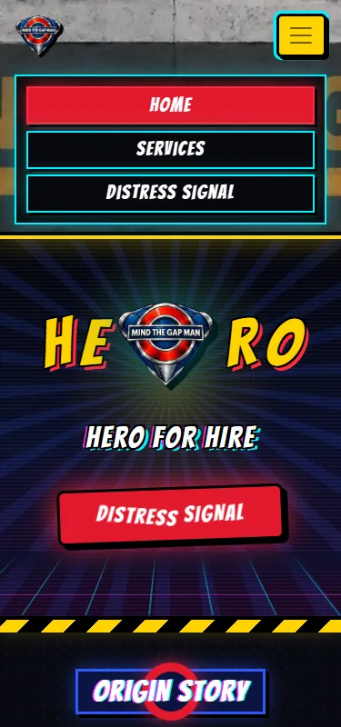

### Home Page (`index.html`)

| Feature | Action | Expected | Result |
| --- | --- | --- | --- |
| HERO banner | Load the page | "HE[logo]RO" letters, the "HERO FOR HIRE" tagline and the button all display, including on mobile | Pass ✅ |
| Spinning logo | Load the page, then hover over the HERO word | The logo spins in once on load, spins clockwise on hover and back anti-clockwise when the pointer leaves | Pass ✅ |
| DISTRESS SIGNAL button | Click | Loads `contact.html` | Pass ✅ |
| Superpowers and Weaknesses list group | View | Both lists display, including "Will not fight south of Zone 4 after 9 PM" | Pass ✅ |
| Services comic strip | Hover, then click | The panel lifts on hover, and the click loads `services.html` | Pass ✅ |
| Comic strip layout | Resize | 3 + 2 panels on desktop, a single column on mobile | Pass ✅ |
| "I can be your Hero..." tier summary | Click the "See prices" button | Loads `services.html` | Pass ✅ |
| Distress Signal SOS card | Click | Loads `contact.html` | Pass ✅ |

### Services Page (`services.html`)

| Feature | Action | Expected | Result |
| --- | --- | --- | --- |
| Service detail cards | View | Six services, each with an image, description and tier badge | Pass ✅ |
| Tier cards | View | Bronze £19, Silver £49 and Gold £199, with response times | Pass ✅ |
| Comparison table | View on mobile (375 px) | The table fits the screen, with each tier name and price on two lines | Pass ✅ |
| Rescue form: required fields | Submit empty | The browser blocks submission and shows a "Please fill in this field" message | Pass ✅ |
| Rescue form: email format | Type `abc` in email and submit | The browser shows an invalid email message | Pass ✅ |
| Rescue form: tier dropdown | Open the select | Lists the Bronze, Silver and Gold options | Pass ✅ |
| Rescue form: labels | Click each label | Focus moves to the matching field | Pass ✅ |
| Rescue form: submit | Submit valid data on the live site | Web3Forms redirects to `thank-you.html`, and an email arrives | Pass ✅ |

### Contact Page (`contact.html`)

| Feature | Action | Expected | Result |
| --- | --- | --- | --- |
| HQ details | View | Fictional hotline, email, address and hours display with icons | Pass ✅ |
| Distress form: required fields | Submit empty | The browser blocks submission and shows validation messages | Pass ✅ |
| Distress form: email format | Enter an invalid email | The browser shows an invalid email message | Pass ✅ |
| Distress form: honeypot | Inspect | The `botcheck` field is hidden from users and skipped by the keyboard | Pass ✅ |
| Distress form: submit | Submit valid data on the live site | Web3Forms redirects to `thank-you.html`, and an email arrives | Pass ✅ |

### Thank You Page (`thank-you.html`)

| Feature | Action | Expected | Result |
| --- | --- | --- | --- |
| Confirmation message | Arrive here after submitting | A clear confirmation that the distress signal was received | Pass ✅ |
| Return links | Click the link back home or to services | The correct page loads | Pass ✅ |
| Navbar state | View | No nav link is marked active | Pass ✅ |

---

## User Story Testing

| User story ([project board](https://github.com/users/cyberjkb/projects/7)) | How the site meets it | Evidence | Result |
| --- | --- | --- | --- |
| **#1 (Must):** Easy navigation and responsive design | Shared navbar (Home, Services, Distress Signal) with a hamburger menu below 1200px, and a Bootstrap grid on every page | [Hamburger menu](assets/images/testing/hamburger-open.webp) and [Responsiveness](#responsiveness-testing) | Pass ✅ |
| **#2 (Must):** Origin story and engaging imagery | HERO banner with spinning logo, slogan and tagline, then the Origin Story artwork and "Bitten by code..." backstory | 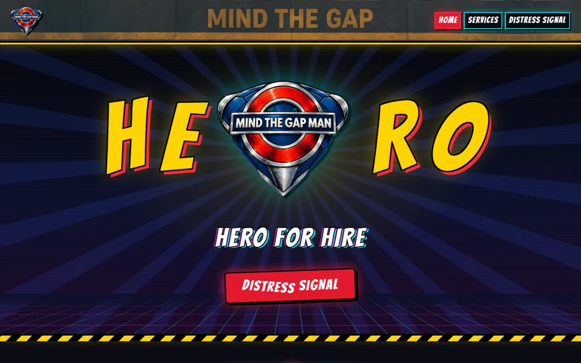 | Pass ✅ |
| **#3 (Must):** Service tiers and pricing on a separate page | `services.html`: six image cards (side by side on desktop, stacked on mobile), three priced tier cards and a comparison table | 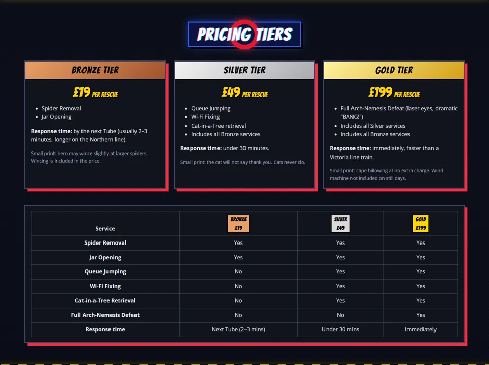 | Pass ✅ |
| **#5 (Must):** Emergency distress signal form | Contact form with required fields; a successful submit redirects to `thank-you.html` | 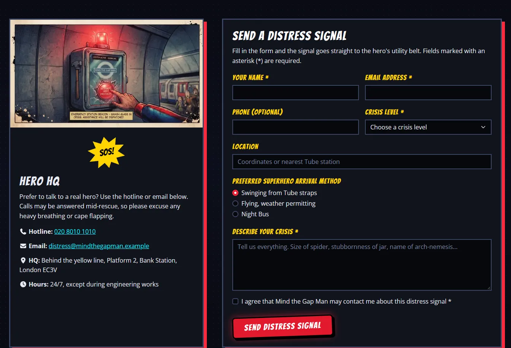 | Pass ✅ |
| **#6 (Should):** Operating hours, zones and contact details | Hero HQ card on the contact page (hotline, email, HQ address, hours); zone limit in the Weaknesses list | 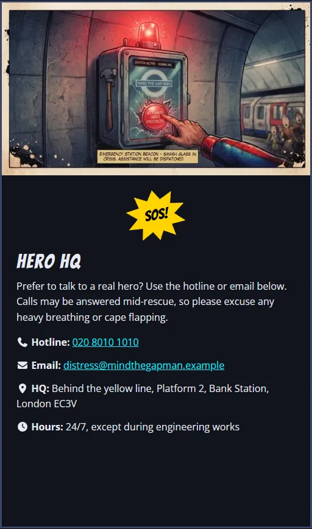 | Pass ✅ |
| **#8 (Could):** "What I won't do" boundaries | Superpowers & Weaknesses list groups on the home page | 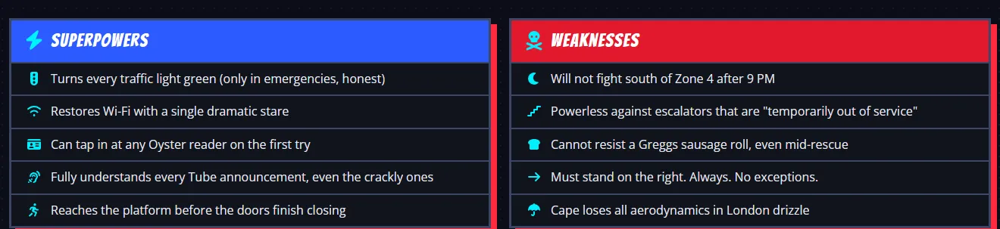 | Pass ✅ |
| **#9 (Could):** Night / day mode switch | Not built in this release (see README › Future Features) | – | Deferred |

---

## Responsiveness Testing

Each page was checked in Chrome DevTools device mode and in real browsers at these widths, checking for: no horizontal scroll, readable text, images that scale, a working navbar collapse, and usable forms. The automated suite also measured horizontal overflow on every page at each width.

| Page | Desktop 1920 px | Laptop 1366 px | Tablet 768 px | Mobile 375 px |
| --- | --- | --- | --- | --- |
| Home | ✅ | ✅ | ✅ | ✅ |
| Services | ✅ | ✅ | ✅ | ✅ |
| Contact | ✅ | ✅ | ✅ | ✅ |
| Thank You | ✅ | ✅ | ✅ | ✅ |

### Browser Compatibility

| Browser | Home | Services | Contact | Thank You | Notes |
| --- | --- | --- | --- | --- | --- |
| Google Chrome | ✅ | ✅ | ✅ | ✅ | Works as expected |
| Mozilla Firefox | ✅ | ✅ | ✅ | ✅ | Works as expected |
| Microsoft Edge | ✅ | ✅ | ✅ | ✅ | Works as expected |
| Safari (macOS / iOS) | ✅ | ✅ | ✅ | ✅ | Works as expected |

✅ = works as expected.

### Screenshots

| Device | Screenshot |
| --- | --- |
| Desktop (1920 px) | 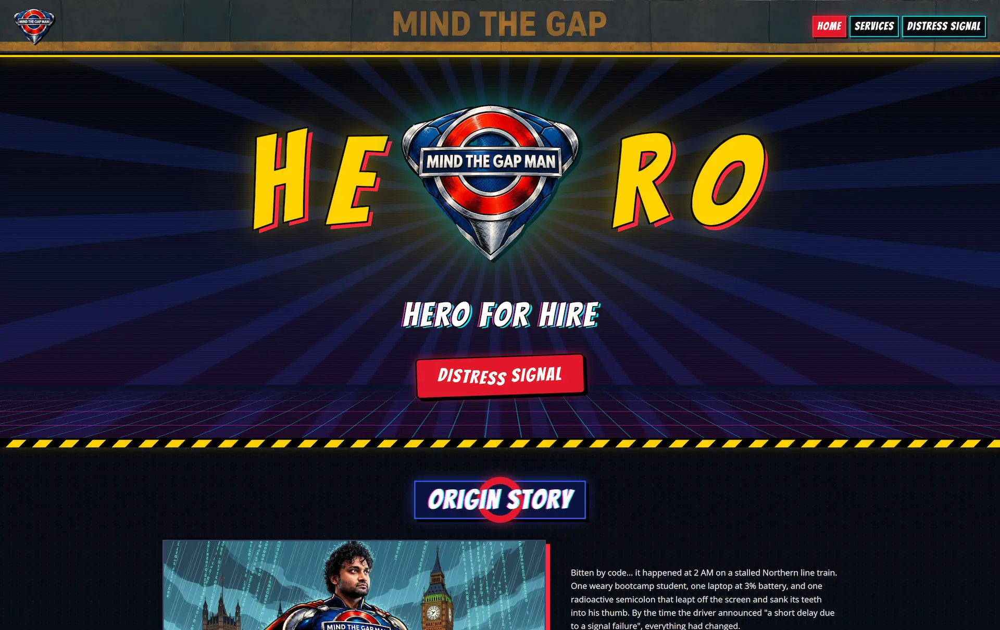 |
| Laptop (1366 px) | 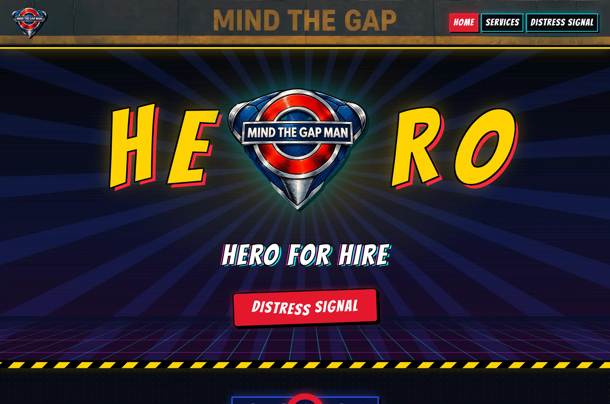 |
| Tablet (768 px) | 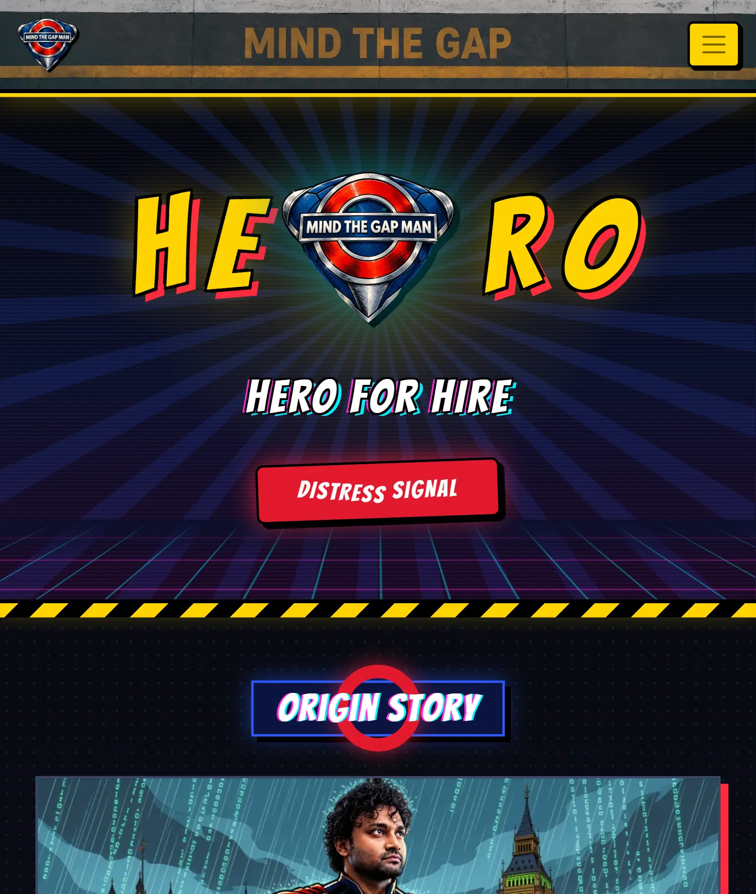 |
| Mobile (375 px) | 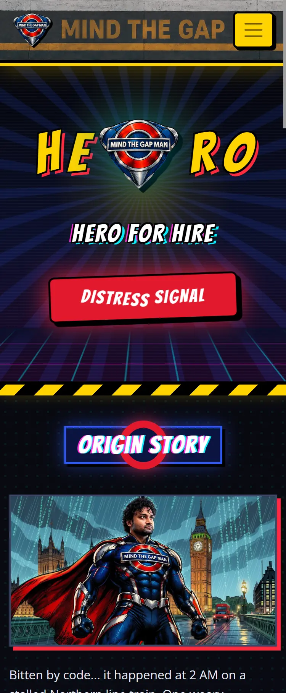 |

---

## Code Validation

### HTML Validation (W3C)

Each live page was checked with the [W3C Nu HTML Checker](https://validator.w3.org/nu/) by URI (`https://cyberjkb.github.io/mind-the-gap/...`) after the final push. The screenshots show the checker's result for the same live page source, submitted through the checker's text input.

| Page | URL | Errors | Warnings | Result | Screenshot |
| --- | --- | --- | --- | --- | --- |
| Home | `https://cyberjkb.github.io/mind-the-gap/index.html` | 0 | 0 | Pass ✅ | 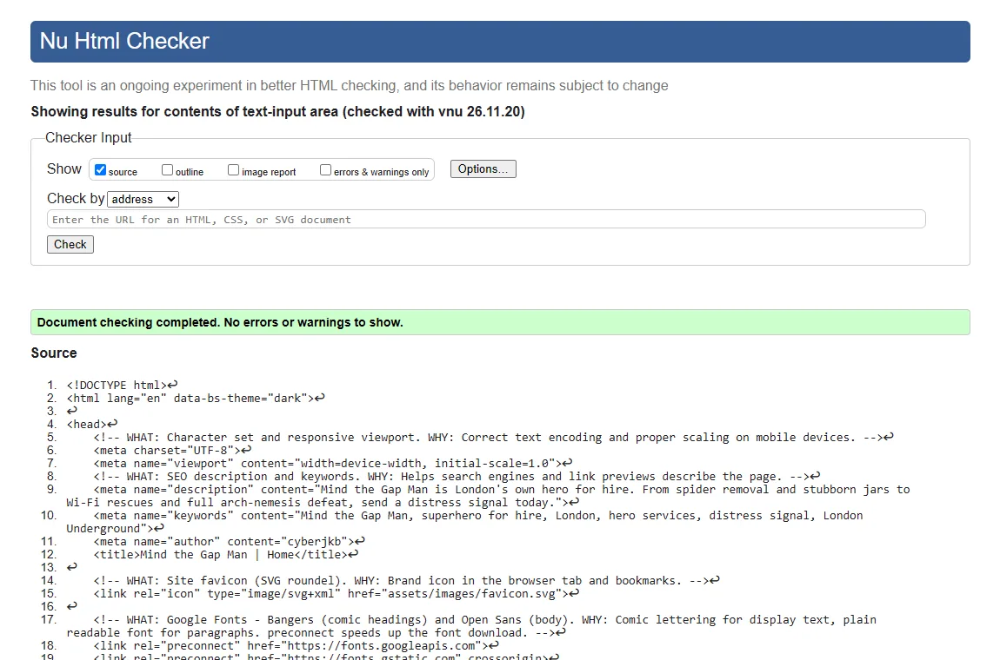 |
| Services | `https://cyberjkb.github.io/mind-the-gap/services.html` | 0 | 0 | Pass ✅ | 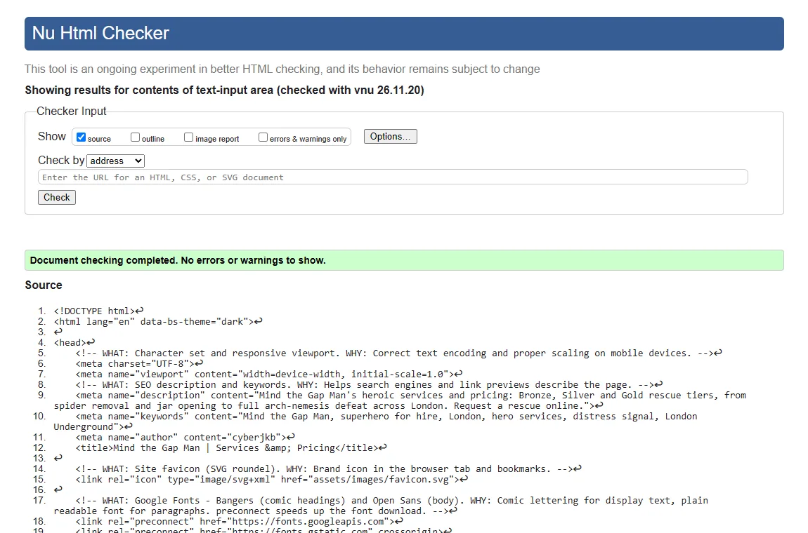 |
| Contact | `https://cyberjkb.github.io/mind-the-gap/contact.html` | 0 | 0 | Pass ✅ | 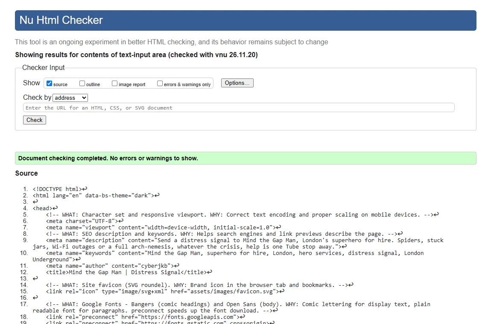 |
| Thank You | `https://cyberjkb.github.io/mind-the-gap/thank-you.html` | 0 | 0 | Pass ✅ | 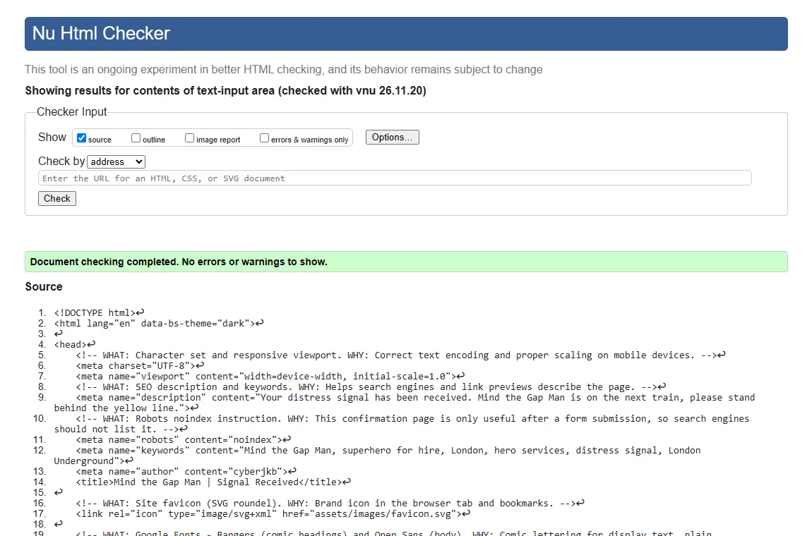 |

### CSS Validation (Jigsaw)

`assets/css/style.css` was validated with the [W3C CSS Validation Service (Jigsaw)](https://jigsaw.w3.org/css-validator/) by file upload, using the **CSS level 3 + SVG** profile.

| File | Errors | Warnings | Result | Screenshot |
| --- | --- | --- | --- | --- |
| `assets/css/style.css` | 0 | 29 | Pass ✅ "Congratulations! No Error Found." | 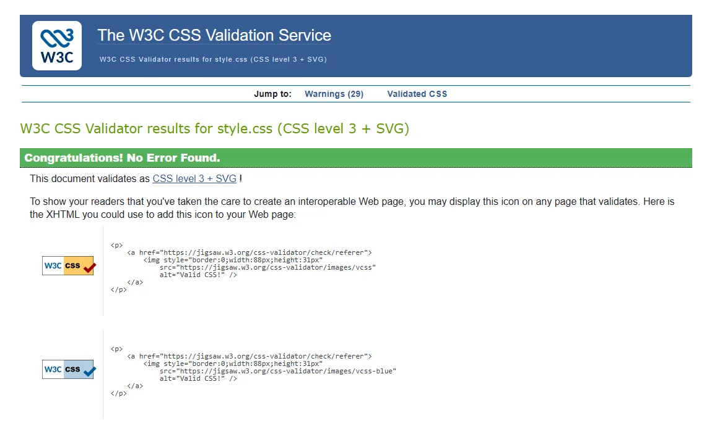 |

> **Note:** All 29 warnings are Jigsaw's standard message that CSS custom properties (`var(--...)`) "cannot be statically checked". These are expected and are not errors. There are no vendor-prefix or other warnings.

---

## Lighthouse Testing

Lighthouse 12.3 reports were generated for every live page in both **Desktop** and **Mobile** modes, in a clean headless Microsoft Edge (Chromium) profile with no extensions, after the final push.

### Lighthouse Score Reference

| Category | Score Range | Indicator | Explanation |
| --- | --- | --- | --- |
| Performance | 90–100 | 🟢 | Fast loading and efficient at runtime |
| Performance | 50–89 | 🟠 | Moderate performance, with room for improvement |
| Performance | 0–49 | 🔴 | Poor performance, usually caused by heavy assets or blocking resources |
| Accessibility | 90–100 | 🟢 | Content is accessible to most users |
| Best Practices | 90–100 | 🟢 | Follows modern, secure web standards |
| SEO | 90–100 | 🟢 | Good visibility to search engines |

### Results Summary

| Page | Mode | Performance | Accessibility | Best Practices | SEO |
| --- | --- | --- | --- | --- | --- |
| Home | Desktop | 🟢 95 | 🟢 100 | 🟢 100 | 🟢 100 |
| Home | Mobile | 🟠 71 | 🟢 100 | 🟢 100 | 🟢 100 |
| Services | Desktop | 🟢 94 | 🟢 100 | 🟢 100 | 🟢 100 |
| Services | Mobile | 🟠 71 | 🟢 100 | 🟢 100 | 🟢 100 |
| Contact | Desktop | 🟢 96 | 🟢 100 | 🟢 100 | 🟢 100 |
| Contact | Mobile | 🟠 73 | 🟢 100 | 🟢 100 | 🟢 100 |
| Thank You | Desktop | 🟢 97 | 🟢 100 | 🟢 100 | 🟠 63 * |
| Thank You | Mobile | 🟠 73 | 🟢 100 | 🟢 100 | 🟠 63 * |

\* **Thank You SEO (63) is intentional.** The page has `<meta name="robots" content="noindex">` so that search engines do not list a form-confirmation page. Lighthouse marks any `noindex` page as "blocked from indexing", which is the only failed SEO audit.

### Home Page

- **Desktop:** Performance 95 · Accessibility 100 · Best Practices 100 · SEO 100
- **Mobile:** Performance 71 · Accessibility 100 · Best Practices 100 · SEO 100

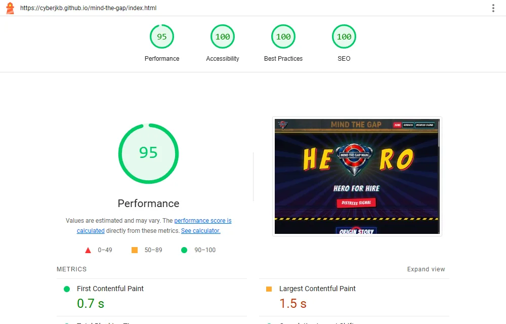
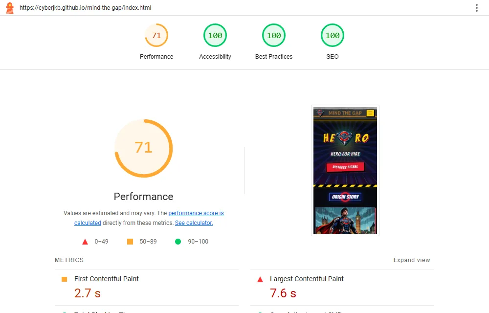

---

### Services Page

- **Desktop:** Performance 94 · Accessibility 100 · Best Practices 100 · SEO 100
- **Mobile:** Performance 71 · Accessibility 100 · Best Practices 100 · SEO 100

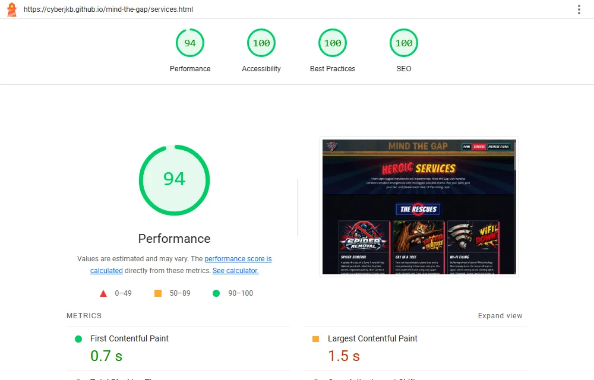
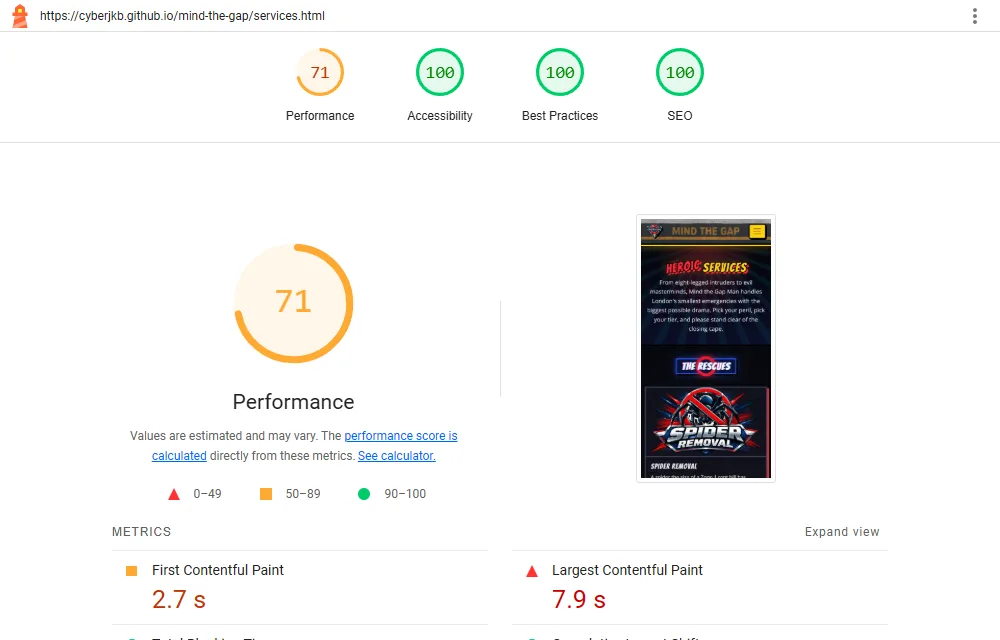

---

### Contact Page

- **Desktop:** Performance 96 · Accessibility 100 · Best Practices 100 · SEO 100
- **Mobile:** Performance 73 · Accessibility 100 · Best Practices 100 · SEO 100

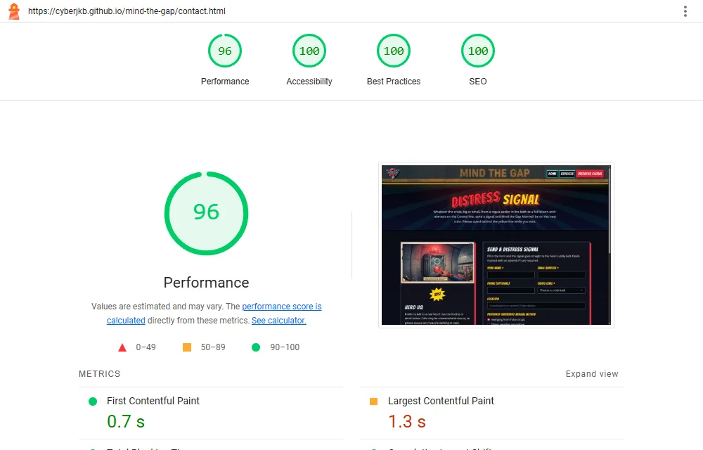
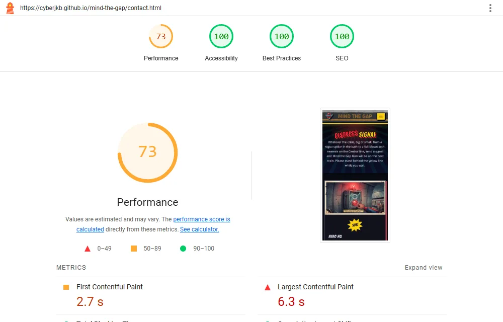

---

### Thank You Page

- **Desktop:** Performance 97 · Accessibility 100 · Best Practices 100 · SEO 63 (intentional `noindex`)
- **Mobile:** Performance 73 · Accessibility 100 · Best Practices 100 · SEO 63 (intentional `noindex`)

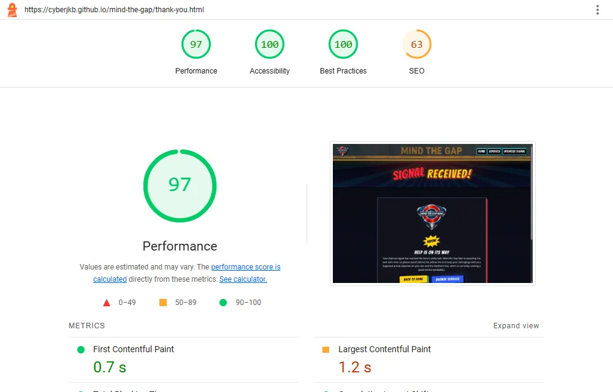
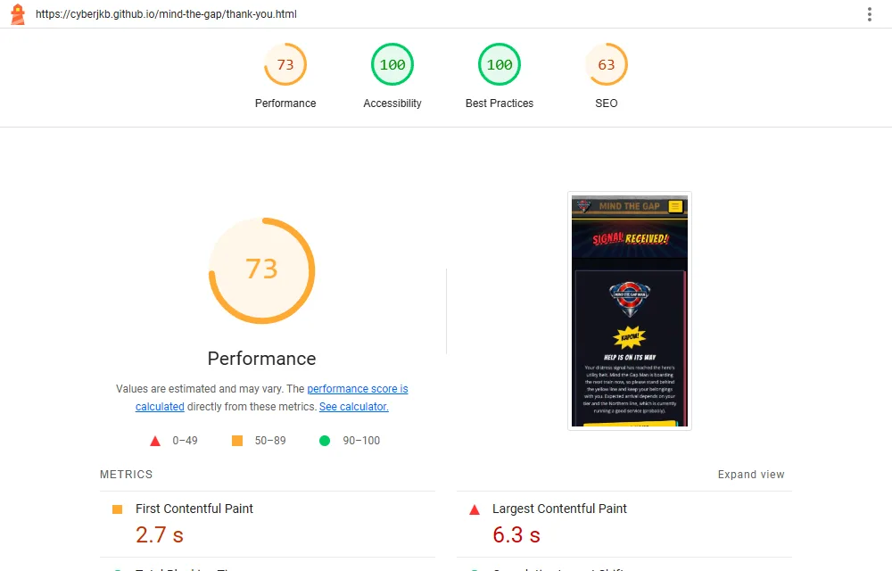

### Performance Considerations

**What was done to improve performance:**

- **Responsive images:** every large image has smaller 300 / 600 / 800 px WebP copies and uses `srcset` and `sizes`, so phones download a file sized for their screen instead of the full-size original. This cut the "properly size images" saving that Lighthouse reported on the home page from 873 KiB to about 240 KiB.
- A 1600 px copy of the navbar photo (27 KB instead of 167 KB) is used on screens below 992 px.
- The Font Awesome kit script is loaded with `defer`, so it no longer blocks the first paint.
- All raster images are WebP and have explicit `width`/`height` attributes, so layout shift is very low (CLS 0.006–0.032).
- `loading="lazy"` defers images below the fold. The above-the-fold logos load eagerly.
- `preconnect` hints for Google Fonts, and `display=swap` to avoid invisible text while the fonts load.
- No custom JavaScript, so Total Blocking Time is 0 ms on every page.

**Why mobile Performance is in the 70s:** the mobile test simulates a mid-range phone on a slow 4G connection. On that connection the Largest Contentful Paint is 6.3–7.9 s. The page itself is light, and in an unthrottled run the largest paint happened in about 0.4 s. The simulated delay comes mostly from third-party files that the page must wait for:

- **Font Awesome kit:** the kit is set to Font Awesome's "SVG + JavaScript" mode, which downloads a 539 KB icon library even though only 21 icons are used.
- **Other CDN files:** the Bootstrap CSS and Google Fonts files each need a connection to a different server.

Switching the kit to Font Awesome's "Web Font" mode (a setting in the Font Awesome account) would be the biggest single improvement. It is listed as a future improvement in the README.

---

## Accessibility Testing

### WAVE (WebAIM)

| Page | Errors | Contrast Errors | Alerts | Result | Screenshot |
| --- | --- | --- | --- | --- | --- |
| Home | 0 | 0 | 4 | Pass ✅ (AIM score 9.9/10) | 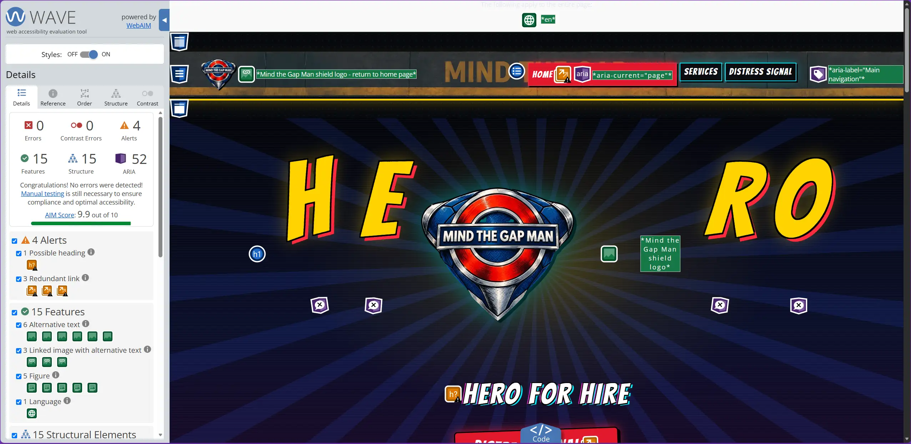 |
| Services | 1 | 0 | 6 | 1 error: hidden honeypot field ⚠️ (AIM score 9.9/10) | 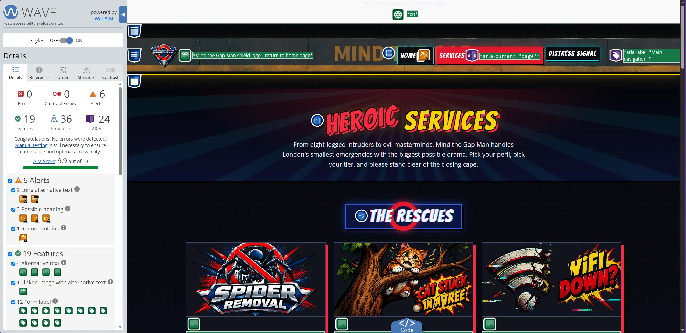 |
| Contact | 1 | 0 | 2 | 1 error: hidden honeypot field ⚠️ (AIM score 9.7/10) | 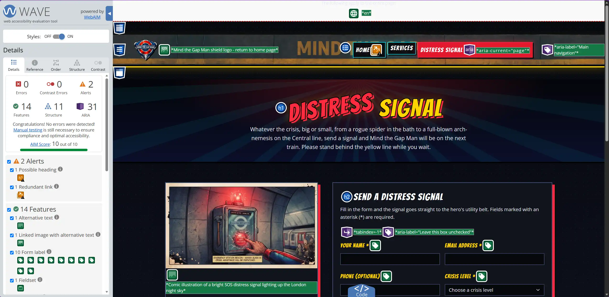 |
| Thank You | 0 | 0 | 2 | Pass ✅ (AIM score 10/10) | 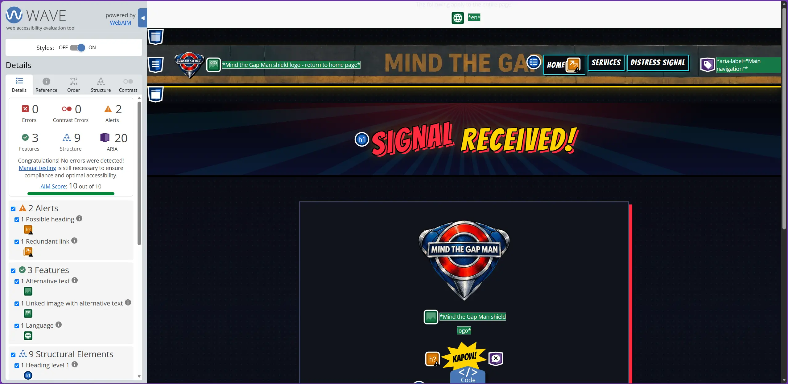 |

> WAVE was run by hand with the WAVE extension in Microsoft Edge on the live site. Lighthouse's accessibility audit (built on the axe-core engine) scores 100 on every page in both modes.
>
> - **Errors (services and contact):** each form has one "Missing form label" error. It is the Web3Forms honeypot checkbox (`botcheck`), a spam trap that is hidden from view and taken out of the tab order with `tabindex="-1"`, so people never reach it. It has no `<label>` on purpose, so WAVE flags it.
> - **Alerts:** "Redundant link" means two nearby links go to the same page, for example the navbar logo and the Home link both pointing to `index.html`. "Possible heading" is styled display text such as "HERO FOR HIRE" and "KAPOW!", which is decorative rather than a real heading. "Long alternative text" on the services page is two service images whose alt text describes the scene in full. None of these alerts are failures.

### Colour Contrast Checks

Ratios were calculated with the WCAG 2.1 relative-luminance formula, which is the same formula the [WebAIM Contrast Checker](https://webaim.org/resources/contrastchecker/) uses. Lighthouse's colour-contrast audit also passes on every page.

| Foreground | Background | Used for | Ratio | WCAG AA (normal / large) | Result |
| --- | --- | --- | --- | --- | --- |
| `--text` #e7e9f2 | `--night` #07080d | Body text | 16.5:1 | Pass / Pass | Pass ✅ |
| `--text` #e7e9f2 | `--panel` #11131c | Card and panel text | 15.3:1 | Pass / Pass | Pass ✅ |
| `--text-muted` #a3abc2 | `--panel` #11131c | Small print, secondary text | 8.1:1 | Pass / Pass | Pass ✅ |
| `--neon-cyan` #00f0ff | `--panel` #11131c | Links | 13.1:1 | Pass / Pass | Pass ✅ |
| `--platform-yellow` #ffd300 | `--panel` #11131c | Form labels, prices, footer heading | 12.9:1 | Pass / Pass | Pass ✅ |
| #000000 | `--platform-yellow` #ffd300 | Comic buttons, captions | 14.6:1 | Pass / Pass | Pass ✅ |
| `--tube-red-dark` #a50e1f | `--platform-yellow` #ffd300 | Tilted red letter on yellow buttons | 5.4:1 | Pass / Pass | Pass ✅ |
| #ffffff | `--tube-red` #e3192d | Distress buttons, active nav link | 4.7:1 | Pass / Pass | Pass ✅ |
| #ffffff | `--tube-blue` #2d5bff | Blue buttons, Superpowers header | 5.2:1 | Pass / Pass | Pass ✅ |
| #ffffff | `--tube-blue-dark` #0b1440 | Section titles | 17.7:1 | Pass / Pass | Pass ✅ |

### Keyboard and Screen Reader

| Test | Expected | Result |
| --- | --- | --- |
| Tab through each page | Focus order is logical and the focus outline is visible on every link, button and field | Pass ✅ (automated suite) |
| Activate the hamburger menu with Enter or Space | The menu opens and closes | Pass ✅ (automated suite) |
| Reduced motion | With "reduce motion" turned on in the operating system, the logo spin, pulsing button and hover animations are switched off | Pass ✅ (`prefers-reduced-motion` rule in `style.css`) |
| Screen reader (NVDA / VoiceOver) reads the social icons | Announces e.g. "Facebook (opens in a new tab)" | ⬜ To confirm (the `aria-label`s are present, verified by the automated suite) |
| Screen reader reads the form labels | Each field is announced with its label | ⬜ To confirm (every field has a matching `<label for>`, verified by the automated suite) |

---

## Bugs

### Fixed

| Bug | Cause | Fix | Status |
| --- | --- | --- | --- |
| Unstable navbar and grid behaviour | A Bootstrap 6 **alpha** CDN build was linked | Replaced with the stable Bootstrap **5.3.3** CSS and JS bundle, with SRI hashes | Fixed ✅ |
| Rotated first letter on headings had no effect | `::first-letter` does not support `transform` | Wrapped the first letter in `` (inline-block), which can be rotated | Fixed ✅ |
| Form did not land on the thank-you page | The Web3Forms `redirect` used a relative path, which cannot resolve from the Web3Forms server | Used the absolute URL `https://cyberjkb.github.io/mind-the-gap/thank-you.html` | Fixed ✅ |
| Lighthouse colour-contrast failure on the home page (Accessibility 95) | The tilted neon-red "See" on the yellow "See prices" button had too little contrast | Tilted letters on yellow buttons now use the darker Underground red (5.4:1). Accessibility is now 100 on every page | Fixed ✅ |
| Contact page scrolled sideways by 12 px on phones (found by the automated suite at 375 px) | The two-column row used Bootstrap's widest gutter (`g-5`, 3rem), whose negative margins are wider than the container's padding on small screens | Changed to `g-4 g-lg-5`, so the wide gutter is only used on large screens | Fixed ✅ |
| Slow mobile loading: Lighthouse reported 873 KiB of oversized images | Full-size images (up to 1367 px) were downloaded even on phones | Added 300 / 600 / 800 px image copies with `srcset` and `sizes`, a smaller navbar photo for phones, and `defer` on the Font Awesome kit | Fixed ✅ |
| WAVE "Missing form label" error on the services and contact pages | The hidden Web3Forms honeypot checkbox (`botcheck`) had no label or accessible name | Added `aria-label="Leave this box unchecked"`, which gives it an accessible name without making it visible | Fixed ✅ (re-scan with WAVE to confirm) |

### Unfixed / Known Limitations

- **Mobile Lighthouse Performance is 71–73.** The main cause is the Font Awesome kit's 539 KB SVG/JavaScript library on a simulated slow 4G connection (see [Performance Considerations](#performance-considerations)). Desktop Performance is 94–97.
- **Thank You page SEO is 63.** This is intentional: `noindex` keeps the confirmation page out of search results.
- **A form submitted from a local copy redirects to the live thank-you page,** because the redirect URL is absolute. This is expected.

---

## Conclusion

Mind the Gap Man was tested against every item on the submission checklist, every user story, every interactive feature, four viewport sizes and four browsers. The testing included a 96-check automated test suite run on the live site.

- **Validation:** all four pages pass the W3C HTML checker with no errors or warnings, and the stylesheet passes Jigsaw with no errors.
- **Lighthouse:** Accessibility and Best Practices are 100 on every page in both desktop and mobile modes. SEO is 100 on every page except the deliberately `noindex` thank-you page. Desktop Performance is 94–97.
- **Mobile Performance:** 71–73, held back mainly by the third-party Font Awesome kit. The cause and the fix are documented above.
- **Bugs found and fixed during testing:** a colour-contrast failure, a 12 px sideways scroll on the contact page, and oversized images on mobile.
- **WAVE:** 0 contrast errors on every page. Home and thank-you have 0 errors. Services and contact had 1 error each, the unlabelled hidden honeypot spam field, which now has an `aria-label`.
- **Still to do by hand:** the screen reader checks.

[Back to top](#mind-the-gap-man--testing-and-validation) · [Back to README](README.md)
